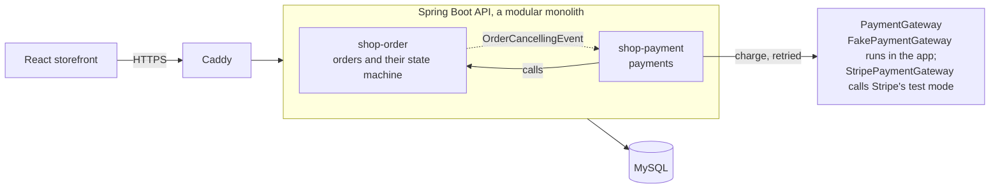
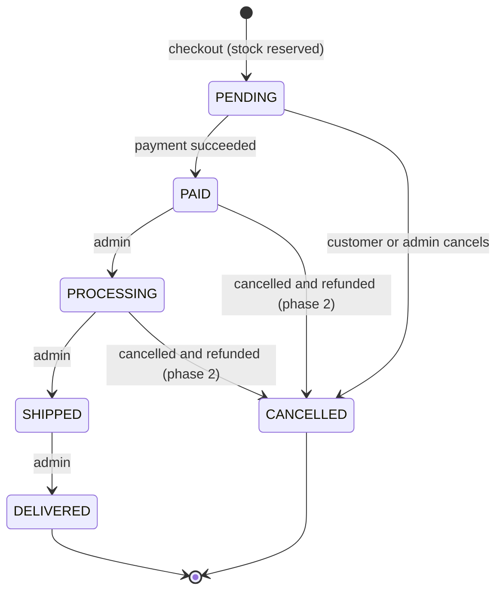
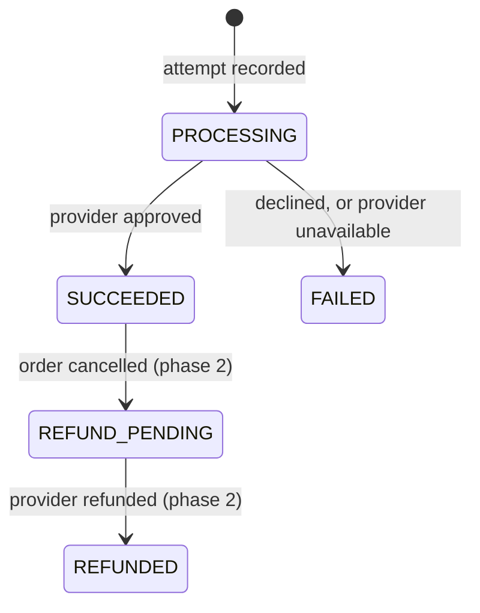
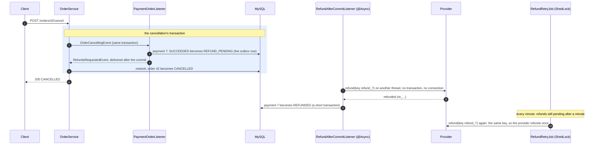
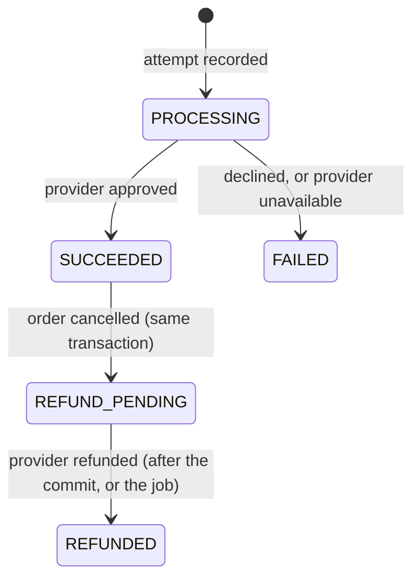
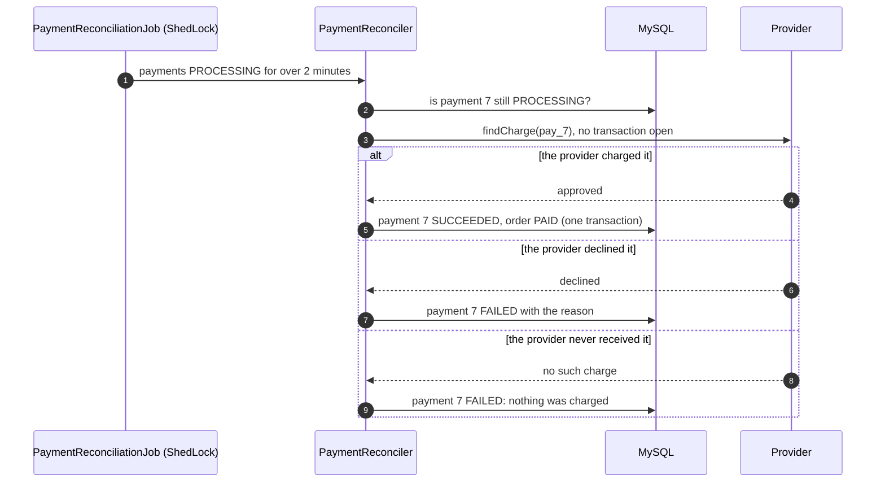
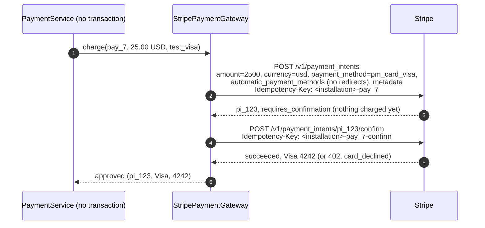

# Payment service design

This is a portfolio project, so the money is simulated, and the server never sees
card data. By default a fake provider inside the app stands in for a real one (much
like a provider's test mode), behind the same interface a real provider sits behind;
Stripe, in test mode, can take its place (section 8). Everything around the provider
(the transactions, idempotency, locking and failure handling) is built the way a
real payment flow needs it.

## 1. Requirements

### What it must do

| # | Requirement | Phase |
|---|---|---|
| F1 | A customer pays for their own order while it is `PENDING`. The amount is the order's total, worked out by the server. | 1 |
| F2 | They pay with a test payment method (`test_visa`, `test_declined`, ...), which stands in for the token a provider's card form returns. The server never sees a card number. | 1 |
| F3 | Paying twice by accident (a double click, a request retried after a timeout) charges once and returns the first result. | 1 |
| F4 | A declined payment leaves the order `PENDING`, and the customer can try another method, up to 5 failed attempts per order. | 1 |
| F5 | A successful payment moves the order to `PAID`. Only then can the shop fulfil it (`PROCESSING`, `SHIPPED`, `DELIVERED`). | 1 |
| F6 | The customer and admins can see an order's payment attempts. | 1 |
| F7 | Cancelling a paid order refunds it in full. | 2 |
| F8 | An order left unpaid for 30 minutes is cancelled and its stock returned. | 2 |
| F9 | A payment whose outcome is unknown (the provider timed out) is settled later by asking the provider. | 2 |

### How well it must do it

- **No double charge, no lost payment, and no charge kept for a cancelled order**,
  with concurrent requests and with a failure at any step.
- **No provider call inside a database transaction.** A transaction holds one of
  the pool's 10 connections until it ends, and a rollback can't undo a charge.
- **Atomic money state.** A payment and its order change together or not at all.
- **Security.** Only the order's owner (or an admin) can pay for it or see its
  payments, the client never sends the amount, and no card data is stored.
- **Audit.** Payment rows are never deleted, and a settled payment's outcome never
  changes; every attempt is kept.

### Out of scope

Live payments and card data (PCI DSS), partial refunds, several currencies, saved
cards, 3-D Secure and payouts. Stripe is used in test mode only (section 8).

## 2. High-level design

### Components



- `shop-payment` is a new module that depends on `shop-order` (and on
  `shop-identity` and `shop-common`). Orders never call payments: when orders are
  being cancelled, `shop-order` publishes an `OrderCancellingEvent` that
  `shop-payment` handles inside the same transaction, the way `UserDeletingEvent`
  already works.
- `PaymentGateway` is the boundary with the provider. `FakePaymentGateway`
  implements it inside the app; `StripePaymentGateway` implements it with Stripe's
  API in test mode (section 8), its key coming only from an environment variable.

### Order lifecycle (changed)



Only a successful payment moves an order to `PAID`; an admin can't set it by hand.
Phase 1 couldn't cancel a paid order, since nothing could give the money back;
phase 2 refunds it (section 4).

### Payment lifecycle



### API

| Method | Path | Who | Result |
|---|---|---|---|
| `POST` | `/api/v1/orders/{orderId}/payments` | the order's owner or an admin | `201` with the new payment (`SUCCEEDED` or `FAILED`); `202` with it `PROCESSING` when the provider didn't answer in time (section 5); `200` with the stored payment when the `Idempotency-Key` was already used for this order |
| `GET` | `/api/v1/orders/{orderId}/payments` | owner or admin | the order's attempts, oldest first (at most 5, so not paginated) |
| `GET` | `/api/v1/orders/{orderId}/payments/{paymentId}` | owner or admin | one attempt |

`POST` takes an `Idempotency-Key` header (8 to 64 letters, digits, `-` or `_`; the
storefront sends a new UUID for each attempt) and a body like
`{"paymentMethod": "test_visa"}`.

### The pay flow: three short steps, and no provider call inside a transaction

```mermaid
sequenceDiagram
    autonumber
    participant C as Client
    participant S as PaymentService (no transaction)
    participant R as PaymentRecorder
    participant DB as MySQL
    participant G as PaymentGatewayClient (@Retryable)
    C->>S: POST /orders/42/payments, Idempotency-Key k1
    S->>R: start(42, k1, test_visa)
    rect rgb(230, 240, 255)
    note over R,DB: transaction 1 (milliseconds)
    R->>DB: lock order 42 (SELECT ... FOR UPDATE)
    R->>DB: a payment with key k1 for order 42? none
    R->>DB: raise order 42's version, INSERT payment 7 (PROCESSING, amount = order total)
    end
    S->>G: charge(provider key pay_7, amount, test_visa)
    note over G: no transaction and no connection held;<br/>retried with the same key if the provider is unavailable
    G-->>S: approved (reference, Visa 4242)
    S->>R: recordSuccess(7, ...)
    rect rgb(230, 240, 255)
    note over R,DB: transaction 2 (milliseconds)
    R->>DB: payment 7 becomes SUCCEEDED
    R->>DB: order 42 becomes PAID
    end
    S-->>C: 201 Created, status SUCCEEDED
```

If the app dies between the steps, the payment stays `PROCESSING`. That blocks
another payment and a cancellation of the order until it is settled, so the order
can't be charged twice, or charged and cancelled. Phase 2's reconciliation job asks
the provider about it (by the same key) and finishes it.

### Key decisions

| Decision | Why | Rejected alternative |
|---|---|---|
| Record the attempt, call the provider, record the result: three steps, two short transactions | A provider call can take seconds. Inside a transaction it would hold a pooled connection that long, and a rollback can't undo a charge anyway | One `@Transactional` method around all of it |
| The client sends an `Idempotency-Key`, unique per order in the database, and a repeat returns the stored payment | After a timeout the client can't tell a lost request from a lost response, so it must be able to send the request again safely | Spotting duplicates by amount and time (guesswork) |
| The provider gets a key of our own, `pay_<payment id>`, on every call and retry of an attempt | The provider deduplicates retries of one attempt, and keys chosen by different clients can never collide there | Passing the client's key on |
| The order row is locked (`SELECT ... FOR UPDATE`) while an attempt starts, and a new attempt raises the order's version | Two attempts for one order run one after the other, and the raised version makes a cancellation running at the same time fail instead of slipping in between | Optimistic checks only: both attempts could pass them |
| At most one payment that isn't `FAILED` per order, enforced by a unique index on a generated column | The rule holds even if some code path forgets the lock | Trusting the service code alone |
| Cancelling an order whose payment is `PROCESSING` is refused (`409`) | The charge may still go through, and cancelling would then keep money for a cancelled order | Cancelling now and refunding later |
| Retry only "provider unavailable", in a separate bean, outside any transaction, with the same provider key | A retry must not repeat database writes, and the key makes the repeated call safe (CLAUDE.md, retries rule) | `@Retryable` on a `@Transactional` method |
| A decline is a result, not an error: `201` with status `FAILED` | The attempt happened and is recorded; the storefront shows the reason and offers another method | An error response that leaves no record |
| At most 5 failed attempts per order | Stops card testing (trying stolen card numbers one after another) and bounds the attempt list | No limit |
| The amount is copied from the order, as `BigDecimal` and `DECIMAL(38,2)`, in a currency set by the server | Floating point loses cents, and the client never decides the price | An amount sent by the client |

## 3. Low-level design

### Classes

In `shop-payment`, package `com.aryan.spring_security_demo.payment`:

| Class | Role | Transaction |
|---|---|---|
| `PaymentController` | The endpoints; validates the `Idempotency-Key` and the body | none |
| `PaymentService` | Runs the three steps of a payment; reads | none for `pay`, read-only for reads |
| `PaymentRecorder` | `start`, `recordSuccess`, `recordFailure` | each a short `@Transactional` of its own (a separate bean, so the proxy applies) |
| `PaymentGatewayClient` | Calls the gateway, `@Retryable` on `PaymentProviderUnavailableException` (2 retries, after 100 ms and 200 ms) | none, by design |
| `PaymentGateway` | The provider boundary: `charge(ChargeRequest)` returns a `ChargeResult` (`Approved` or `Declined`), or throws `PaymentProviderUnavailableException` | |
| `FakePaymentGateway` | The test payment methods below; remembers each result by provider key, so a repeated key gets the first result | |
| `Payment`, `PaymentStatus`, `PaymentRepository` | The entity, its state machine and its queries | |
| `PaymentOrderListener` | Refuses to cancel an order while one of its payments is `PROCESSING` | joins the cancellation's transaction (`MANDATORY`) |

Changes in `shop-order`:
- `OrderStatus` gets `PAID`.
- `OrderService.lockForPayment` (lock the order and check the caller owns it),
  `startPayment` (raise the locked order's version, for a new attempt only) and
  `markPaid` (`PENDING` to `PAID`, read under a lock). All three require the
  caller's transaction (`MANDATORY`).
- `updateStatus` refuses `PAID`.
- Cancelling orders publishes an `OrderCancellingEvent`.

### Test payment methods

| Method | Result |
|---|---|
| `test_visa` | approved, Visa ending in 4242 |
| `test_mastercard` | approved, Mastercard ending in 4444 |
| `test_declined` | declined: "Your card was declined." |
| `test_insufficient_funds` | declined: "Your card has insufficient funds." |
| `test_flaky` | provider unavailable on the first try of each charge, approved on the retry |
| `test_provider_down` | provider unavailable every time, so `FAILED` once the retries run out |
| anything else | declined: "Unknown payment method." |

### Data model (`V11__payments.sql`)

```sql
create table payment (
    id                 bigint not null auto_increment,
    version            bigint not null,
    order_id           bigint not null,
    idempotency_key    varchar(64) not null,
    payment_method     varchar(64) not null,
    amount             decimal(38,2) not null,
    currency           varchar(3) not null,
    status             enum ('FAILED','PROCESSING','SUCCEEDED') not null,
    provider_reference varchar(64),
    card_brand         varchar(20),
    card_last4         varchar(4),
    failure_reason     varchar(255),
    created_at         datetime(6) not null,
    completed_at       datetime(6),
    -- The order's id unless the payment FAILED, else null; a unique index ignores nulls.
    live_order_id      bigint generated always as (case when status <> 'FAILED' then order_id end) stored,
    primary key (id),
    constraint uk_payment_order_idempotency_key unique (order_id, idempotency_key),
    constraint uk_payment_live_order unique (live_order_id),
    constraint uk_payment_provider_reference unique (provider_reference),
    constraint chk_payment_amount_positive check (amount > 0),
    constraint fk_payment_order foreign key (order_id) references orders (id)
) engine=InnoDB;
```

`orders.order_status` gets `PAID`. Orders are never deleted (deleting an account
only unlinks them), so the foreign key needs no `on delete` rule.

### What happens when

| Situation | Result |
|---|---|
| The same key and method again, for the same order | `200` with the stored payment, even while it is still `PROCESSING` |
| The same key with another method | `409`, key reused |
| The order isn't `PENDING` (paid, cancelled, ...) | `409` |
| Another payment of the order is `PROCESSING` | `409` |
| 5 failed attempts already | `409` |
| Someone else's order | `403`; an order that doesn't exist, `404` |
| `Idempotency-Key` missing or malformed, or no payment method | `400` |
| Declined | `201` with status `FAILED` and the reason; the order stays `PENDING` |
| Provider still unavailable after the retries | `201`, `FAILED`, "payment provider unavailable". Safe, because an unavailable provider never took the charge |
| Cancelling while a payment is `PROCESSING` | `409` |
| An admin sets the status to `PAID` | `409` |

### Concurrency

| Race | What prevents the bug | Integration test checks |
|---|---|---|
| Double click: the same key twice at once | The order lock makes them take turns, and the second finds the first's payment and returns it | one charge, one payment id |
| Two tabs: different keys at once | The order lock; the second then sees a payment in progress or an order no longer pending. The unique `live_order_id` is the backstop | exactly one `SUCCEEDED` payment and one charge |
| Paying and cancelling at once | The lock and version bump: a cancellation that read the order before the attempt started fails its version check, and one that reads it after sees the `PROCESSING` payment and is refused | never `CANCELLED` with a `SUCCEEDED` payment |
| The provider call and the connection pool | No transaction is open during the call | a spy on the gateway sees no active transaction |

**A bug the double-click test caught.** The first version raised the order's
version whenever it locked the order, including for a repeated request. That
repeat committed its raised version while the first request was still waiting
for the provider, so the first request's "record the result" transaction failed
its version check: the card was charged, the payment stayed `PROCESSING`, and the
customer got a `409`. Now only a new attempt raises the version (a repeat starts
nothing, so it has no cancellation to fence off), and `markPaid` reads the order
under a lock, so recording a result always works from the latest version.

## 4. Phase 2: refunds

Cancelling a paid order (by the customer, an admin, or deleting the account) now
refunds it in full. The refund has to survive two things a transaction can't
cover: a provider that is down, and the app stopping between the cancellation and
the refund call.

### The flow: an outbox row, then the provider after the commit



- **The outbox row is written in the cancellation's transaction.** The order
  becoming `CANCELLED` and the payment becoming `REFUND_PENDING` commit together or
  not at all, so a cancelled order always has a record that money is owed back,
  even if the app stops a moment later.
- **The provider is called only after the commit.** Calling it inside the
  transaction would hold a pooled connection, and if the transaction then rolled
  back, the customer would be refunded for an order that wasn't cancelled.
- **The after-commit listener runs `@Async`.** Spring runs an `AFTER_COMMIT`
  listener *before* it releases the transaction's connection and unbinds its
  resources (`AbstractPlatformTransactionManager.processCommit`: `doCommit`, then
  `triggerAfterCommit`, then `cleanupAfterCompletion`). A provider call made right
  there would hold the request's connection for as long as it takes. A
  `@Transactional` method called from there would also join the transaction that
  has already committed, and its writes would be silently lost. On a background
  thread there is neither problem, and the cancel request doesn't wait for the
  provider.
- **The recorder's refund methods are `REQUIRES_NEW`.** On the background thread or
  in the job, that is simply a new transaction; if the listener were ever made
  synchronous again, it would still keep the write out of the committed one.
- **The listener catches every failure and leaves the row pending.** The
  transaction has committed by then, so there is nothing left to roll back;
  `RefundRetryJob` retries every refund still pending a minute after it was
  requested (one instance at a time, through ShedLock).
- **Every call for one refund uses the key `refund_<payment id>`.** The listener,
  its retries and the job can all reach the provider for the same refund, and the
  provider refunds it once. Recording an outcome that is already recorded does
  nothing.

### Payment lifecycle, completed



The charge's own facts (amount, provider reference, card) never change; a refund
adds its own reference and times. `V12__payment_refunds.sql` adds the two statuses,
`refund_reference` (unique), `refund_requested_at` and `refunded_at`, and an index
for the job's query.

### What happens when

| Situation | Result |
|---|---|
| A paid (or processing) order is cancelled | `200`, order `CANCELLED`, stock returned, payment `REFUND_PENDING`, then `REFUNDED` a moment later |
| The provider is down when the refund is first tried | The payment stays `REFUND_PENDING`; the job refunds it once the provider is back |
| The app stops right after the cancellation commits | The row is `REFUND_PENDING`; the job finds it on the next run |
| The listener and the job reach the provider for one refund | The same key: refunded once, recorded once |
| An unpaid order is cancelled | No payment to refund; as before |
| An order whose payment is `PROCESSING` is cancelled | `409`, as before: the charge may still go through |

A new test method, `test_refund_down`, charges normally, but the provider fails the
first 3 refund calls (the first try and its 2 retries), so the job's later attempt
is the one that succeeds.

## 5. Phase 2: reconciliation

A payment is recorded as `PROCESSING` before the provider is called, and settled
after. If the settling never happens, it stays `PROCESSING`, and its order can be
neither paid again nor cancelled. Three things can cause that:

- **The provider times out** after the request was sent: it may or may not have
  charged.
- **The app stops** between the provider's answer and recording it.
- **Recording the answer fails** (the database is briefly unreachable) after the
  provider approved.

In every case the provider knows what happened. Reconciliation asks it.



- **The provider is the source of truth.** The payment's key, `pay_<payment id>`,
  is what the charge was sent under, so the provider can say exactly what happened
  to that attempt. If the provider is unavailable, the payment stays `PROCESSING`
  until the next run.
- **Only after 2 minutes.** A request may still be waiting on the provider; 2
  minutes is well past any request's provider timeout, so the job never settles an
  attempt the request is still settling. If both get there anyway, they settle it
  from the same answer, and recording an outcome that is already recorded does
  nothing.
- **A timeout is answered, not failed.** A timed-out charge isn't retried inside
  the request (each try could take the full timeout, holding the customer's
  request) and isn't marked failed (it may have charged). The request answers
  `202 Accepted` with the payment `PROCESSING`; the storefront shows that the
  payment is being confirmed, and updates once the job settles it.
- **"Never received" is safe to fail** only because of the 2 minutes: by then a
  request that hasn't reached the provider never will.

Two new test methods make the cases reproducible: `test_timeout_charged` (the
provider charges, and then the answer is lost) and `test_timeout_not_charged` (the
request never reaches the provider). Like the fake provider's other answers, what
it charged is kept in memory, so after a restart it reports every earlier charge as
never received; a real provider remembers.

No new columns: the job's query (`status = 'PROCESSING' and created_at < ?`) uses
the `status`-led index from `V12`.

## 6. Phase 2: unpaid order expiry

Checkout takes the items out of stock straight away, so an order nobody pays for
holds them forever. An order still `PENDING` 30 minutes after it was placed
(`app.orders.unpaid-expiry`) is cancelled, and its items go back on sale.

- **The order module owns it.** `UnpaidOrderExpiryJob` (ShedLock, every minute)
  finds the unpaid orders placed before the cutoff, and cancels each through
  `OrderService.expireIfUnpaid`: the same cancellation as the customer's (restock
  under product locks, `OrderCancellingEvent`), without the ownership check.
- **One transaction per order.** The job calls a public `@Transactional` method on
  another bean, so each order goes through Spring's proxy and commits or rolls back
  alone, and holds its product locks only as long as its own cancellation. The
  order's status and age are checked again inside that transaction: it may have
  been paid since the scan.
- **Payments still have a say.** An order with a payment `PROCESSING` may still be
  charged, so the payment module refuses its cancellation (`409`). The job leaves
  that order and tries again on a later run, after reconciliation (section 5) has
  settled the payment.
- **Paying at the last second is safe.** A new payment attempt raises the order's
  version, so an expiry that read the order before fails its version check; an
  expiry that commits first leaves the order `CANCELLED`, and the payment request
  gets a `409`. Either way the order is never cancelled with money taken.
- **The customer is told.** While an order is unpaid, the API returns `payBy` (when
  it was placed plus the window), and the order page says "Pay by ...".

`V13__orders_status_created_index.sql` adds `(order_status, created_at)` for the
job's query; the existing index leads with `user_id`.

## 7. Phase 3: webhooks

A real provider also reports what happened by calling the shop: a **webhook**, an
HTTP request it sends when a charge succeeds or fails, or a refund goes through.
Webhooks settle a payment the shop couldn't (a timeout) in seconds, rather than
when reconciliation next runs. The jobs stay as the safety net, because a webhook
can be late, repeated, out of order, or never arrive.

```mermaid
sequenceDiagram
    autonumber
    participant G as Provider (FakePaymentGateway)
    participant W as POST /api/v1/payments/webhooks
    participant DB as MySQL
    G->>W: event evt_1 (charge.succeeded for pay_7), Payment-Signature: t=..., v1=HMAC
    W->>W: check the signature (constant time) and the timestamp (within 5 minutes)
    rect rgb(230, 240, 255)
    note over W,DB: one transaction
    W->>DB: INSERT event evt_1 (unique event id)
    W->>DB: lock payment 7, SUCCEEDED; order PAID
    end
    W-->>G: 200
    G->>W: evt_1 again (the provider retries, or delivers twice)
    W->>DB: evt_1 already recorded: nothing to do
    W-->>G: 200
```

- **Authenticated by signature, not by JWT.** The provider has no user token, so
  the endpoint is `permitAll`, and every request must carry
  `Payment-Signature: t=<unix seconds>,v1=<hex HMAC-SHA256>`, computed over
  `<t>.<raw body>` with a secret only the provider and the shop know
  (`PAYMENT_WEBHOOK_SECRET`). The signature is checked over the raw bytes received
  (parsing and re-serializing the JSON could change them), with a constant-time
  comparison, so its timing reveals nothing about the right value.
- **Replay protection.** A captured request can't be sent again later: the
  timestamp is part of what is signed, and one more than 5 minutes from the shop's
  clock is refused.
- **Exactly-once effect from at-least-once delivery.** Providers deliver an event
  at least once: retries after a timeout, duplicates. Each event id is recorded in
  `payment_webhook_event` (unique) in the same transaction as the change it makes,
  so the change happens once: a repeat finds the id and does nothing, and two
  deliveries at the same moment collide on the unique key, the loser rolled back
  and answered `200` as already done.
- **Same transitions as everywhere else.** A webhook settles a payment through the
  same recorder methods as the request, reconciliation and the refund job, so
  whatever arrives first records the outcome and the rest change nothing.
  Recording an outcome now locks the payment row first, so two recorders at the
  same moment take turns instead of the second failing its version check (a `409`
  for a payment that succeeded).
- **Unknown events are acknowledged.** An event type the shop doesn't handle, or
  for a payment it doesn't know, is recorded and answered `200`; refusing it would
  only make the provider retry forever.

The fake provider sends `charge.succeeded`, `charge.failed` and `refund.succeeded`
about a second after it answers (the way a real one does), over HTTP to
`app.payment.fake.webhook-url`, signed with the same secret. A real provider
retries a failed delivery for days; the fake tries once, and a lost webhook is
left to reconciliation and the refund job. Webhooks are off until both the secret
and the URL are set: staging and production send them to the API itself.

`V14__payment_webhook_events.sql` adds the event table. It keeps the payment's id
as a plain column, not a foreign key, since an event can name a payment the shop
doesn't know.

## 8. Stripe in test mode

The fake provider shows the design; this section plugs in a real provider, Stripe,
in **test mode**: its real API and real webhooks, with test cards and no real
money. `app.payment.provider` chooses:

- `fake` (the default): the tests, CI, staging and the E2E tests. It needs no
  network and no secret, and it can simulate what a real provider won't do on
  request: timeouts, outages and a refund that fails a few times.
- `stripe`: a developer's machine, with a test key in `.env`.

Only the edges change: `PaymentGateway` gets a second implementation, and the
webhook endpoint a second reader. The pay flow, the recorders, the jobs and the
tables stay as they are.

```mermaid
flowchart LR
    C[PaymentGatewayClient<br/>@Retryable] --> G{{PaymentGateway}}
    G --> F[FakePaymentGateway]
    G --> S[StripePaymentGateway<br/>RestClient] -->|HTTPS, Idempotency-Key| API[Stripe API, test mode]
    API -->|webhook| CLI[stripe listen<br/>on the developer's machine]
    CLI -->|Stripe-Signature| W[POST /api/v1/payments/webhooks]
    W --> R[StripeWebhookReader] --> P[PaymentWebhookProcessor]
```

### Test mode only

The app refuses to start with `provider: stripe` unless `STRIPE_SECRET_KEY` is a
test-mode key (`sk_test_...` or a restricted `rk_test_...`), so this project can't
move real money however it is configured. The key comes only from the environment:
`.env` locally, which git ignores, and the local hooks refuse to commit.

### Charging in two idempotent steps



A PaymentIntent is Stripe's record of one payment. Creating it charges nothing;
confirming it charges the card. Splitting the two is what lets a lost answer be
looked up safely (below). Every request carries a key Stripe deduplicates by, so the
retries of `PaymentGatewayClient` repeat the same two requests and Stripe answers
them from its first result.

What each failure means:

| Step | Failure | Card charged? | Result |
|---|---|---|---|
| create | can't connect, timeout, `401`/`403` (a bad key), `429`, `5xx` | no: nothing is confirmed yet | unavailable: retried, then `FAILED` |
| create | another `4xx`, such as an amount under Stripe's minimum | no | declined, with a plain reason (Stripe's message goes to the log) |
| confirm | can't connect | no: the request never left | unavailable: retried with the same keys |
| confirm | `402`, a card error | no | declined, with Stripe's message (`Your card was declined.`) |
| confirm | another `4xx` | no | declined, with a plain reason (Stripe's message goes to the log) |
| confirm | timeout, connection lost, `5xx` | maybe | outcome unknown: `PROCESSING`, `202`, settled by reconciliation |

Amounts go to Stripe in the currency's smallest unit (cents for USD), worked out
from the currency's decimal places, exactly or not at all. Stripe's messages can be
longer than the 255 characters `failure_reason` holds, so a payment keeps the first
254 and an ellipsis.

Only Stripe's card errors (`card_error`) are shown to the customer: Stripe writes
those for customers ("Your card was declined."), and its other messages for
developers.

The first run against Stripe's test mode found three faults that the unit tests,
which replay answers written by hand, could not:

- The account's API version no longer accepted `payment_method_types`, which the
  adapter sent. The create request now sends `automatic_payment_methods` (Stripe
  picks the methods, never one that redirects), and every request pins the API
  version it was tried against.
- That refusal (280 characters) was too long for `failure_reason`, so recording the
  decline failed and left the payment `PROCESSING`, and its text was a developer's
  message about a parameter. Long reasons are now cut to fit, and the customer sees
  a plain reason.
- Reconciliation then sent the fixed create under the old keys, which Stripe
  refused as `idempotency_error`, and the adapter took that for a decline. Correct
  that time (Stripe had refused those requests outright), but not in general: it is
  now left for a person, as above.

### Looking up a lost charge

Stripe replays a request only if both its key and its parameters match the first
one, so `findCharge` now takes the original `ChargeRequest` (the reconciler rebuilds
it from the payment row) instead of just its key. It:

1. Sends the create request again. Stripe answers with the PaymentIntent from the
   first time, or creates it now if the first never arrived: unconfirmed either
   way, so nothing is charged. If Stripe won't replay it (`idempotency_error`: the
   request has changed since it was sent, after a deploy), that says nothing about
   the charge, so the payment stays `PROCESSING` and an error asks a person to
   settle it from the dashboard. Calling it declined could hide a charge.
2. Reads the PaymentIntent's status:

| Status | Meaning | Answer |
|---|---|---|
| `succeeded` | charged | approved |
| `requires_payment_method`, with a payment error | declined | declined, with Stripe's message |
| `requires_confirmation` | the confirm never arrived | cancel it, then "never received" |
| `canceled` | | "never received" |
| anything else (`processing`, ...) | still settling | unavailable: the next run asks again |

Cancelling the unconfirmed PaymentIntent makes "never received" final: a confirm
still on its way would now fail rather than charge. Stripe's Search API could find
the PaymentIntent by its metadata instead, but it lags behind writes by up to a
minute and isn't offered in every country.

### Refunds

`refund` sends `POST /v1/refunds` for the PaymentIntent and the payment's amount,
under the key `<installation>-refund_7`. Can't connect, a timeout, a `401`/`403`,
`429` or `5xx` is "unavailable": the refund stays `REFUND_PENDING`, and the retry job
sends the same request again, which Stripe answers with the first refund. A refund
Stripe accepts, whether succeeded or still pending while the card network carries
the money back, is recorded as refunded. Any other error, or a refund Stripe
reports as failed, is logged and left `REFUND_PENDING` for a person: retrying
can't change Stripe's answer.

### Keys that can't collide: the installation id

Stripe remembers an idempotency key for 24 hours, per account, and sends webhooks
about every payment in the account. But `pay_7` is unique only within one database.
A local database wiped and created again starts at payment 1 again, and a second
database (another developer's laptop) on the same Stripe account has its own
payment 7. Unchecked, the new payment 7 could get the old one's answer for a day
(approved without being charged), or have another database's webhook applied to it.

So `V16__installation.sql` gives each database a random id, which MySQL generates
once when the migration runs. The adapter starts every Stripe key with it and puts
it in the metadata of every PaymentIntent and refund, and a webhook whose metadata
names another installation is acknowledged and ignored. The fake provider keeps
its answers in memory per app, so it doesn't need this.

### Webhooks

Stripe signs its webhooks the way the fake does: `Stripe-Signature: t=...,v1=...`,
an HMAC-SHA256 over `<t>.<raw body>`, with a `whsec_...` secret that goes in
`PAYMENT_WEBHOOK_SECRET`. `WebhookSignature` checks both, and now accepts any of
several `v1` values, which Stripe sends while a secret is being rotated.
`StripeWebhookReader` turns Stripe's events into the shop's:

| Stripe event | Shop event | Payment found by |
|---|---|---|
| `payment_intent.succeeded` | `charge.succeeded` | the PaymentIntent's metadata, `shop_charge_key` |
| `payment_intent.payment_failed` | `charge.failed` | the same |
| `refund.created` or `refund.updated`, with status `succeeded` | `refund.succeeded` | the refund's metadata, `shop_refund_key` |
| anything else | none: recorded and acknowledged | |

From there the processor, the recorders and the exactly-once rules of section 7
are unchanged. Stripe can't reach a laptop, so locally the Stripe CLI relays them:
`stripe listen --events payment_intent.succeeded,payment_intent.payment_failed,refund.created,refund.updated --forward-to localhost:8082/api/v1/payments/webhooks`,
with the `whsec_` secret that `stripe listen --print-secret` shows. Tried that way,
each of those events was answered `200`, and one Stripe sent again was recognised
as a duplicate. A `payment_intent` event doesn't name the card, so a payment
that a webhook settles first is shown without its brand and last four digits.

### Test cards

The storefront keeps its test methods; the adapter maps them to Stripe's test
PaymentMethods. Real Stripe won't time out or go down on request, so the methods
that simulate that stay with the fake: the adapter declines them, saying why,
without calling Stripe.

| Shop method | Stripe test PaymentMethod |
|---|---|
| `test_visa` | `pm_card_visa` |
| `test_mastercard` | `pm_card_mastercard` |
| `test_declined` | `pm_card_chargeDeclined` |
| `test_insufficient_funds` | `pm_card_chargeDeclinedInsufficientFunds` |

### Testing

- Unit tests replay Stripe's responses through Spring's `MockRestServiceServer`:
  every row of the failure table, each status of the lookup, refunds and the
  webhook translation. They need no network and no key, so they run in CI.
- CI, staging and the E2E tests keep the fake provider.
- The README explains how to try it against Stripe's test mode by hand.

### Key decisions

| Decision | Why | Rejected alternative |
|---|---|---|
| Spring's `RestClient` against Stripe's HTTP API | Every request, key and error is visible in the code; `MockRestServiceServer` tests it without a network; no extra dependency to keep free of CVEs | Stripe's Java SDK |
| Create, then confirm, each with its own key | A lost charge can be looked up without charging anyone | One create with `confirm=true`: asking again would charge |
| Test-mode keys only, checked at startup | The project can't move real money, whatever its configuration | Trusting the configuration |
| The fake stays the default | Tests and CI stay offline, deterministic and free of secrets, and keep their simulated failures | Stripe in CI |
| An installation id in every key and in the metadata | Databases sharing a Stripe account can't receive each other's answers or events | `pay_<id>` alone |
| Stripe's test PaymentMethods, chosen on the server | The API and webhooks are real without a card form in the browser | Stripe Elements now (on the roadmap) |
| Every request pins `Stripe-Version: 2026-09-30.endive`, the version it was tried against | The account's default version changes when the account is upgraded, and a new version can drop a parameter the adapter sends (as `payment_method_types` was dropped) | The account's default version |

## 9. Roadmap

- **Phase 1**, done (#177): everything in sections 1 to 3, the pay step on the
  storefront's order page, and tests (unit, integration against MySQL,
  end-to-end).
- **Phase 2**, done: refunds when a paid order is cancelled (section 4, #178),
  reconciliation of payments stuck in `PROCESSING` (section 5, #179), and expiry of
  orders left unpaid (section 6, #180).
- **Phase 3**, done: provider webhooks with a signature check (section 7, #181),
  and Stripe in test mode (section 8).
- **Next:** Stripe's card form in the browser (Stripe Elements), with 3-D Secure;
  partial refunds.
