# Payment service design

This is a portfolio project, so the money is simulated, and the server never sees
card data. A fake provider inside the app stands in for a real one by default, and
Stripe in test mode can take its place (section 8). Everything around the provider
(transactions, idempotency, locking, failure handling) is built the way a real
payment flow needs it. This version keeps the diagrams and tables; the full
write-up, with every step argued, is
[the earlier version](https://github.com/Aryankanani1/shopping-cart-spring-security/blob/dfc3b6deb1e356205e3256a92039188989898a09/docs/payment-design.md).

## 1. Requirements

| # | Requirement | Phase |
|---|---|---|
| F1 | A customer pays for their own order while it is `PENDING`; the server works out the amount. | 1 |
| F2 | They pay with a test payment method (`test_visa`, ...), standing in for a card form's token. | 1 |
| F3 | Paying twice by accident charges once and returns the first result. | 1 |
| F4 | A declined payment leaves the order `PENDING`, up to 5 failed attempts. | 1 |
| F5 | A successful payment moves the order to `PAID`; only then is it fulfilled. | 1 |
| F6 | The customer and admins can see an order's payment attempts. | 1 |
| F7 | Cancelling a paid order refunds it in full. | 2 |
| F8 | An order left unpaid for 30 minutes is cancelled and its stock returned. | 2 |
| F9 | A payment whose outcome is unknown is settled later by asking the provider. | 2 |

Non-functional: no double charge, no lost payment, no charge kept for a cancelled
order; no provider call inside a database transaction; a payment and its order
change together; only the owner (or an admin) pays or sees payments; payment rows
are never deleted.

Out of scope: live payments and card data (PCI DSS), several currencies, saved
cards, 3-D Secure and payouts.

## 2. High-level design

### Components

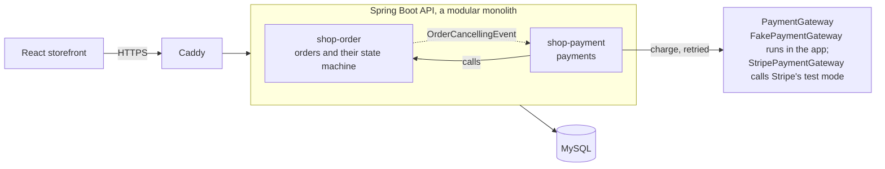

`shop-payment` depends on `shop-order`; orders never call payments, they publish
events the payment module handles in the same transaction.

### Order lifecycle (changed)

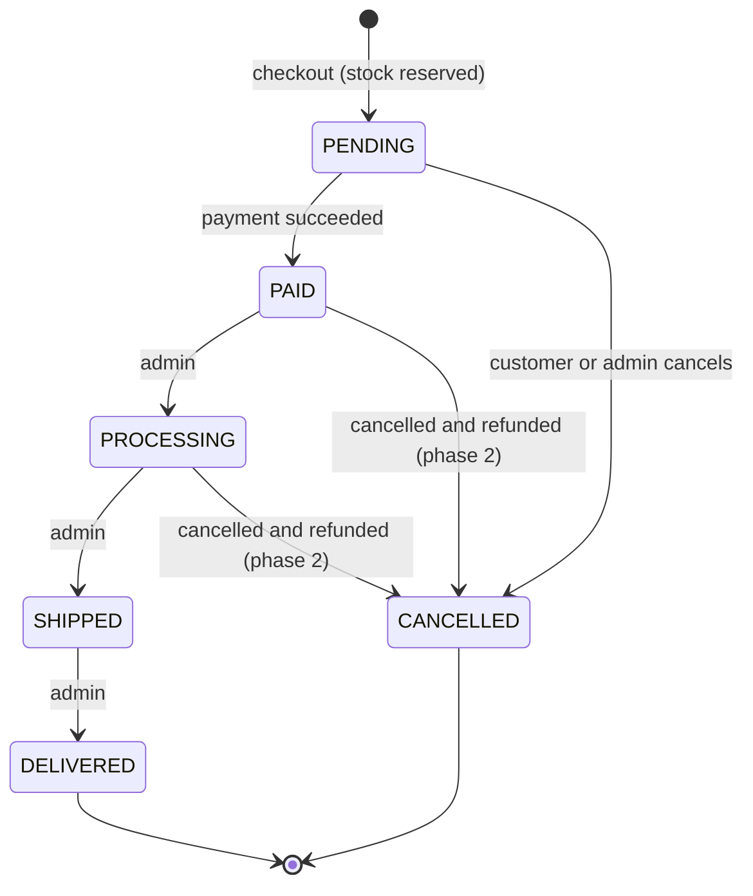

### Payment lifecycle

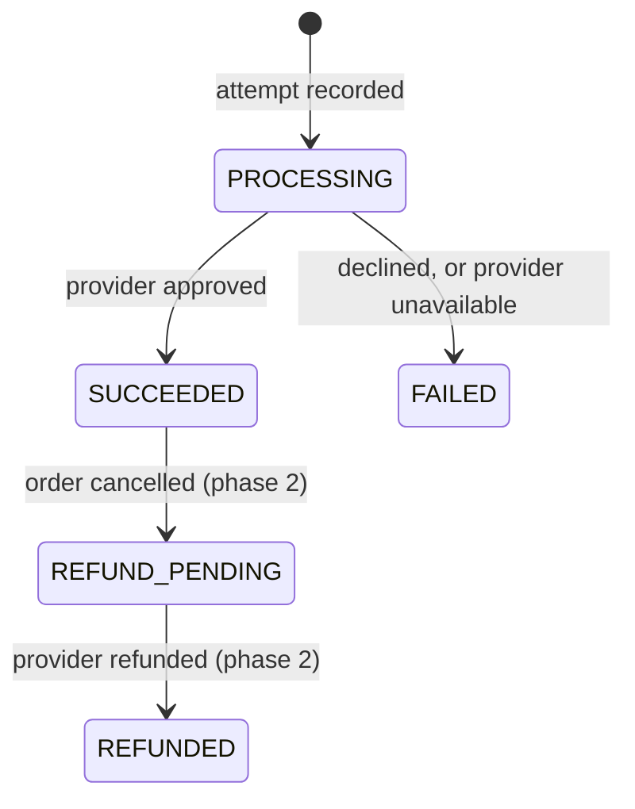

### API

| Method | Path | Who | Result |
|---|---|---|---|
| `POST` | `/api/v1/orders/{orderId}/payments` | owner or admin | `201` (`SUCCEEDED` or `FAILED`); `202` (`PROCESSING`, provider timed out); `200` for a repeated `Idempotency-Key` |
| `GET` | `/api/v1/orders/{orderId}/payments` | owner or admin | the order's attempts, oldest first |
| `GET` | `/api/v1/orders/{orderId}/payments/{paymentId}` | owner or admin | one attempt |

`POST` takes an `Idempotency-Key` header and `{"paymentMethod": "test_visa"}`.

### The pay flow: three short steps, and no provider call inside a transaction

```mermaid
sequenceDiagram
    autonumber
    participant C as Client
    participant S as PaymentService (no transaction)
    participant R as PaymentRecorder
    participant DB as MySQL
    participant G as PaymentGatewayClient (Retry)
    C->>S: POST /orders/42/payments, Idempotency-Key k1
    S->>R: start(42, k1, test_visa)
    rect rgb(230, 240, 255)
    note over R,DB: transaction 1 (milliseconds)
    R->>DB: lock order 42 (SELECT ... FOR UPDATE)
    R->>DB: a payment with key k1 for order 42? none
    R->>DB: raise order 42's version, INSERT payment 7 (PROCESSING, amount = order total)
    end
    S->>G: charge(provider key pay_7, amount, test_visa)
    note over G: no transaction and no connection held;<br/>retried with the same key if the provider is unavailable
    G-->>S: approved (reference, Visa 4242)
    S->>R: recordSuccess(7, ...)
    rect rgb(230, 240, 255)
    note over R,DB: transaction 2 (milliseconds)
    R->>DB: payment 7 becomes SUCCEEDED
    R->>DB: order 42 becomes PAID
    end
    S-->>C: 201 Created, status SUCCEEDED
```

If the app stops between the steps, the payment stays `PROCESSING`, which blocks
another payment and a cancellation until reconciliation settles it (section 5).

### Key decisions

| Decision | Why | Rejected alternative |
|---|---|---|
| Record the attempt, call the provider, record the result: two short transactions | A rollback can't undo a charge, and a slow provider would hold a pooled connection | One `@Transactional` method around all of it |
| A client `Idempotency-Key`, unique per order | After a timeout the client can resend safely | Spotting duplicates by amount and time |
| The provider gets our own key, `pay_<payment id>` | It deduplicates our retries, and keys can't collide | Passing the client's key on |
| Lock the order while an attempt starts, and raise its version | Attempts take turns, and a racing cancellation fails its version check | Optimistic checks only |
| One payment that isn't `FAILED` per order, by a unique index | Holds even if code forgets the lock | Trusting the service code |
| Cancelling while a payment is `PROCESSING` is refused (`409`) | The charge may still go through | Cancelling now, refunding later |
| Retry only "provider unavailable", outside any transaction | Repeats no database writes; the key makes the call safe | `@Retryable` on a `@Transactional` method |
| A decline is a result: `201` with `FAILED` | The attempt happened and is recorded | An error that leaves no record |
| At most 5 failed attempts per order | Stops card testing | No limit |
| The amount is the order's, as `BigDecimal` / `DECIMAL(38,2)` | No floating-point cents; the client never sets the price | An amount sent by the client |

## 3. Low-level design

### Classes

In `shop-payment`, package `com.aryan.spring_security_demo.payment`:

| Class | Role | Transaction |
|---|---|---|
| `PaymentController` | The endpoints | none |
| `PaymentService` | Runs the three steps of a payment; reads | none for `pay` |
| `PaymentRecorder` | `start`, `recordSuccess`, `recordFailure` | each a short one of its own |
| `PaymentGatewayClient` | Retry and fallback around the gateway (section 10) | none, by design |
| `PaymentGateway` | The provider boundary: `FakePaymentGateway`, `StripePaymentGateway` | |
| `Payment`, `PaymentStatus`, `PaymentRepository` | The entity, its state machine, its queries | |
| `PaymentOrderListener` | Hands the order module's events to the checkout saga (section 13) | joins the order's transaction |

### Test payment methods

| Method | Result |
|---|---|
| `test_visa`, `test_mastercard` | approved |
| `test_declined`, `test_insufficient_funds` | declined |
| `test_flaky` | unavailable once, then approved |
| `test_provider_down` | unavailable every time: `FAILED` after the retries |
| `test_refund_down` | approved; its first 3 refund calls fail (section 4) |
| `test_timeout_charged`, `test_timeout_not_charged` | the answer is lost; reconciliation settles it (section 5) |
| `test_late_charge` | declined, then charged and reported by webhook (section 14) |

### Data model (`V11__payments.sql`)

```sql
create table payment (
    id                 bigint not null auto_increment,
    version            bigint not null,
    order_id           bigint not null,
    idempotency_key    varchar(64) not null,
    payment_method     varchar(64) not null,
    amount             decimal(38,2) not null,
    currency           varchar(3) not null,
    status             enum ('FAILED','PROCESSING','SUCCEEDED') not null,
    provider_reference varchar(64),
    card_brand         varchar(20),
    card_last4         varchar(4),
    failure_reason     varchar(255),
    created_at         datetime(6) not null,
    completed_at       datetime(6),
    -- The order's id unless the payment FAILED, else null; a unique index ignores nulls.
    live_order_id      bigint generated always as (case when status <> 'FAILED' then order_id end) stored,
    primary key (id),
    constraint uk_payment_order_idempotency_key unique (order_id, idempotency_key),
    constraint uk_payment_live_order unique (live_order_id),
    constraint uk_payment_provider_reference unique (provider_reference),
    constraint chk_payment_amount_positive check (amount > 0),
    constraint fk_payment_order foreign key (order_id) references orders (id)
) engine=InnoDB;
```

### What happens when

| Situation | Result |
|---|---|
| The same key and method again | `200` with the stored payment |
| The same key with another method | `409` |
| The order isn't `PENDING`, or another payment is `PROCESSING`, or 5 attempts failed | `409` |
| Someone else's order / no such order | `403` / `404` |
| Declined | `201`, `FAILED`, the order stays `PENDING` |
| Provider still unavailable after the retries | `201`, `FAILED`: nothing was charged |
| Cancelling while a payment is `PROCESSING`, or an admin setting `PAID` | `409` |

### Concurrency

| Race | What prevents the bug |
|---|---|
| Double click: the same key twice at once | The order lock; the second finds the first's payment |
| Two tabs: different keys at once | The order lock, then the unique `live_order_id` as backstop |
| Paying and cancelling at once | The lock and version bump: the cancellation fails its version check or sees `PROCESSING` |
| The provider call and the connection pool | No transaction is open during the call |

## 4. Phase 2: refunds

Cancelling a paid order refunds it in full. The refund is owed in the
cancellation's transaction and sent after the commit, so it survives a provider
that is down and an app that stops in between. Since sections 12 and 13 the refund
is owed by the checkout saga and sent through the outbox.

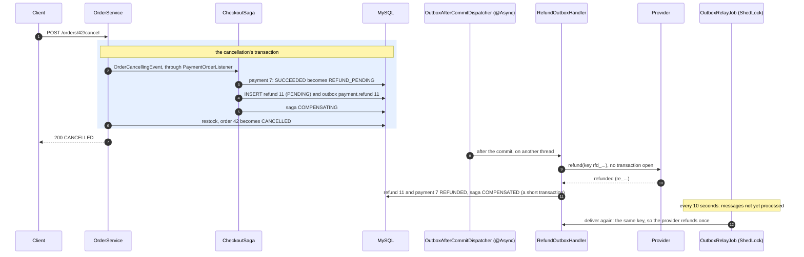

### Payment lifecycle, completed

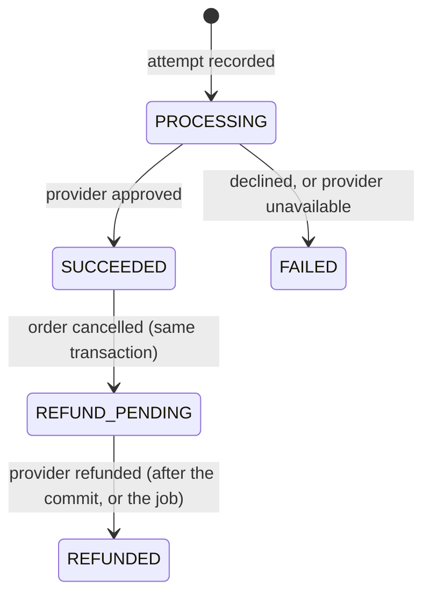

## 5. Phase 2: reconciliation

A payment stays `PROCESSING` if its outcome is lost (a timeout, or the app stopped
before recording it). After 2 minutes, a job asks the provider, under the same key,
what happened. A timed-out request answers `202`.

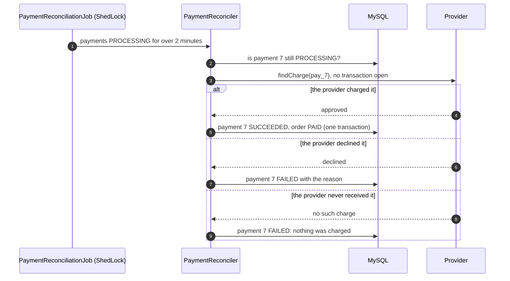

## 6. Phase 2: unpaid order expiry

An order still `PENDING` 30 minutes after it was placed (`app.orders.unpaid-expiry`)
is cancelled and restocked, one transaction per order. Since section 13 this is the
checkout saga's deadline, `CheckoutDeadlineJob`. An order whose payment is
`PROCESSING` is left for a later run; the API shows the customer `payBy`.

## 7. Phase 3: webhooks

The provider also reports outcomes by calling the shop. Webhooks settle payments in
seconds; the jobs stay as the safety net.

```mermaid
sequenceDiagram
    autonumber
    participant G as Provider (FakePaymentGateway)
    participant W as POST /api/v1/payments/webhooks
    participant DB as MySQL
    G->>W: event evt_1 (charge.succeeded for pay_7), Payment-Signature: t=..., v1=HMAC
    W->>W: check the signature (constant time) and the timestamp (within 5 minutes)
    rect rgb(230, 240, 255)
    note over W,DB: one transaction
    W->>DB: INSERT event evt_1 (unique event id)
    W->>DB: lock payment 7, SUCCEEDED; order PAID
    end
    W-->>G: 200
    G->>W: evt_1 again (the provider retries, or delivers twice)
    W->>DB: evt_1 already recorded: nothing to do
    W-->>G: 200
```

- Authenticated by an HMAC signature over the raw body (`PAYMENT_WEBHOOK_SECRET`),
  compared in constant time, and refused if more than 5 minutes old.
- Each event id is recorded in the same transaction as its change: exactly-once
  effect from at-least-once delivery (`V14__payment_webhook_events.sql`).

## 8. Stripe in test mode

`app.payment.provider` is `fake` (the default: tests, CI, staging) or `stripe`
(test mode, a developer's key in `.env`; the app refuses a live key).

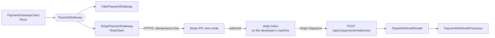

### Charging in two idempotent steps

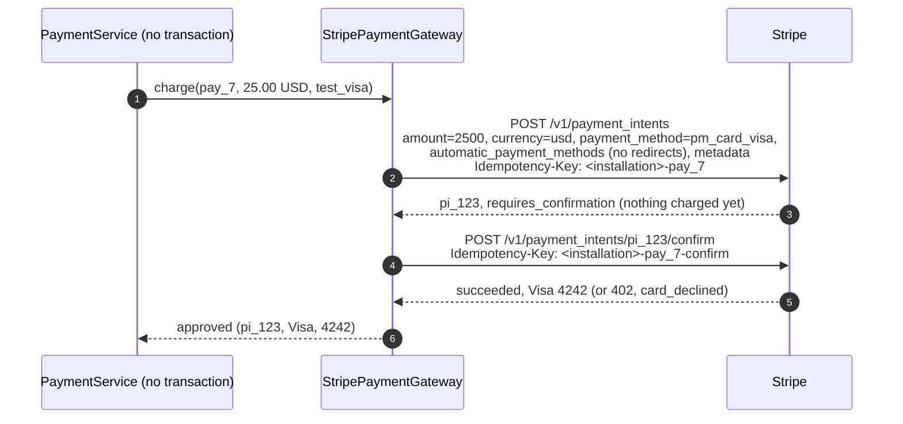

| Step | Failure | Card charged? | Result |
|---|---|---|---|
| create | can't connect, timeout, `401`/`403`, `429`, `5xx` | no | unavailable: retried, then `FAILED` |
| create | another `4xx` | no | declined |
| confirm | can't connect | no | unavailable: retried with the same keys |
| confirm | `402` card error, another `4xx` | no | declined |
| confirm | timeout, connection lost, `5xx` | maybe | `PROCESSING` (`202`), settled by reconciliation |
| confirm | left unfinished (`requires_action`) | not yet | cancelled, then declined (section 14) |

A lost charge is looked up by sending the same create again (Stripe replays it),
then reading the PaymentIntent; one never confirmed is cancelled, so it can't
charge later. Every key starts with the database's installation id (V16), so
databases sharing a Stripe account can't collide.

### Key decisions

| Decision | Why | Rejected alternative |
|---|---|---|
| Spring's `RestClient` against Stripe's HTTP API | Every request and error visible; tested without a network | Stripe's Java SDK |
| Create, then confirm, each with its own key | A lost charge can be looked up without charging | `confirm=true` on create |
| Test-mode keys only, checked at startup | Can't move real money | Trusting the configuration |
| The fake stays the default | Tests and CI stay offline and deterministic | Stripe in CI |
| An installation id in every key | Databases sharing an account can't collide | `pay_<id>` alone |
| Every request pins `Stripe-Version` | An account upgrade can't drop a parameter we send | The account's default version |

## 9. Circuit breaker on Stripe

When Stripe keeps failing, a Resilience4j breaker stops calling it for 30 seconds
and callers take their existing "unavailable" paths.

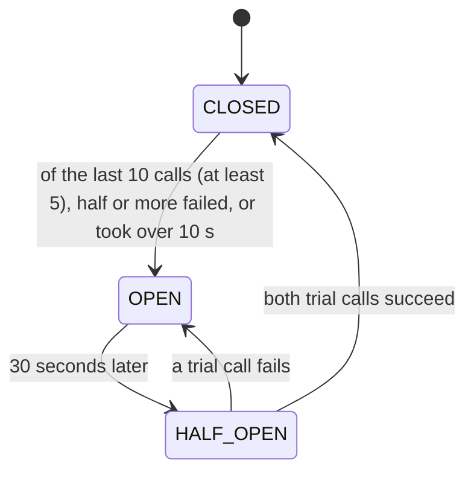

| Outcome of a Stripe call | For the breaker |
|---|---|
| Unavailable, outcome unknown, or slower than 10 s | failure |
| Approved, declined, refunded, a refused refund | success: Stripe answered |
| A lookup answered without settling | ignored |

| Caller | While the breaker is open |
|---|---|
| Paying | `503` with `Retry-After: 30`, before an attempt is recorded |
| Refunding | Stays owed; the outbox relay tries again |
| Reconciliation | Stays `PROCESSING`; the next run asks again |

The breaker shows in the health details as `CIRCUIT_OPEN`, never `DOWN`, and is
never part of readiness: an outage at Stripe can't take the shop out of the load
balancer.

## 10. Retries and fallbacks, with Resilience4j

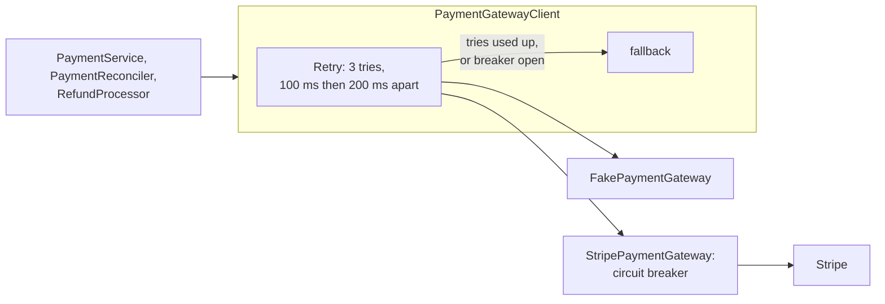

| What the provider said | Retried? |
|---|---|
| Unavailable | yes: 3 tries, 100 ms and 200 ms apart, same key |
| Outcome unknown, breaker open, lookup not settled, any answer | no |

| Call | Fallback result | What the caller does |
|---|---|---|
| `charge` | `ChargeResult.Unavailable` | Records the payment `FAILED`: nothing was charged |
| `findCharge` | `ChargeLookup.Unanswered` | Leaves it `PROCESSING` for the next run |
| `refund` | `RefundAttempt.StillOwed` | Leaves the refund owed for the outbox relay |

The fake provider's webhook deliveries have a retry (3 tries, scheduled, never
slept) and a breaker of their own. Admins see both under `/actuator/circuitbreakers`
and `/actuator/retries`.

## 11. Partial refunds

An admin can refund part of a paid order, as often as money is left: items sent
back, or an amount.

| Kind | The admin gives | Amount | Stock |
|---|---|---|---|
| `ITEMS` | order items and quantities, a reason | each quantity times the price paid | back in stock if asked |
| `AMOUNT` | an amount and a reason | as given, at most what is left | unchanged |
| `CANCELLATION` | nothing: cancelling the order | what is left | items not already refunded |
| `LATE_CHARGE` | nothing: a charge after a failure (section 14) | all of it | unchanged |

### Data model

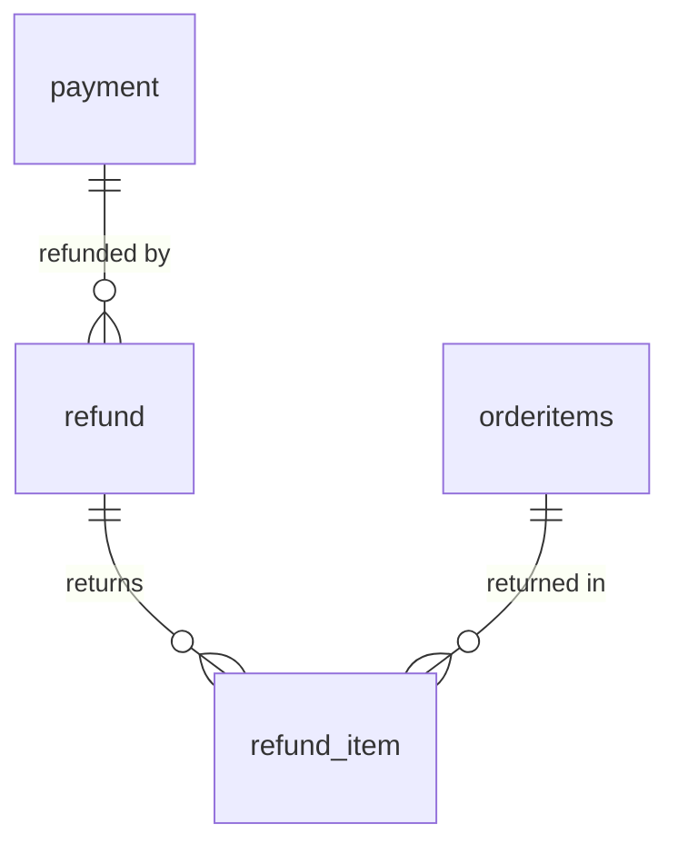

The payment keeps running totals, `refund_requested_amount` and `refunded_amount`,
with a check constraint that they never exceed the amount paid
(`V17__partial_refunds.sql`).

### Lifecycle

```mermaid
stateDiagram-v2
    SUCCEEDED --> SUCCEEDED: part refunded
    SUCCEEDED --> REFUNDED: partial refunds reach the amount paid
    SUCCEEDED --> REFUND_PENDING: order cancelled; a refund for what is left
    REFUND_PENDING --> REFUNDED: refunded
```

### The flow

```mermaid
sequenceDiagram
    autonumber
    participant A as Admin
    participant R as RefundService
    participant DB as MySQL
    participant G as PaymentGatewayClient
    A->>R: POST /orders/42/refunds (items or amount, reason), Idempotency-Key k
    rect rgb(230, 240, 255)
    note over R,DB: one transaction
    R->>DB: lock the order's payment (SELECT ... FOR UPDATE), before any other read
    R->>DB: a refund with key k already? return it
    R->>DB: items: check and raise refunded quantities, restock if asked
    R->>DB: amount <= paid - refund_requested_amount, else 409
    R->>DB: INSERT refund (PENDING) and its outbox message; raise refund_requested_amount
    end
    R-->>A: 201, refund PENDING
    R->>G: after the commit, through the outbox: refund (its key rfd_..., amount)
    G-->>R: refunded, or still owed (the outbox relay tries again)
    R->>DB: lock the payment, then the refund: REFUNDED, raise refunded_amount; payment REFUNDED if every cent is back
```

Everything that refunds a payment locks its row first, and the totals live on that
row: under MySQL's `REPEATABLE READ`, refunds read after the lock could be stale.

### API

| Method | Path | Who | Result |
|---|---|---|---|
| `POST` | `/api/v1/orders/{orderId}/refunds` | admins | `201` (`PENDING`); `200` for a repeated `Idempotency-Key`; `409` for more than is left |
| `GET` | `/api/v1/orders/{orderId}/refunds` | owner or admin | the order's refunds |
| `GET` | `/api/v1/orders/{orderId}/refunds/{refundId}` | owner or admin | one refund |

### Key decisions

| Decision | Why | Rejected alternative |
|---|---|---|
| A `refund` table, one row per refund | Many refunds per payment, each with its own key | Refund columns on the payment |
| The server prices item refunds | What goes back is what was paid | Client-sent amounts |
| Lock the payment row, keep totals on it, check constraint | Two refunds at once can't exceed what was paid | Summing refund rows |
| Refunded quantities on the order item | The order module owns items and stock | Counting refund rows from the order module |
| An order's status doesn't change | A delivered order with a return is still delivered | A `PARTIALLY_REFUNDED` status |

## 12. The transactional outbox

Work that must follow a commit (sending a refund) is written as an
`outbox_message` in the same transaction as the change that owes it, then delivered
after the commit and retried until done (`V18__outbox.sql`).

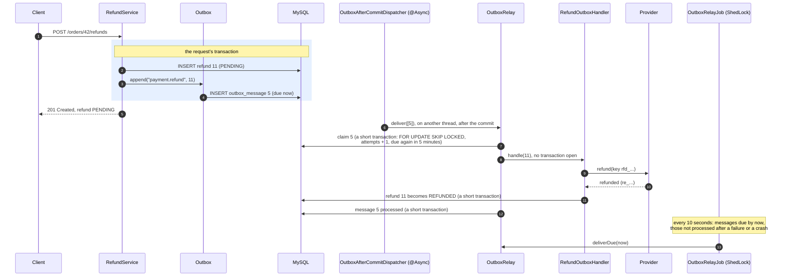

### A message's life

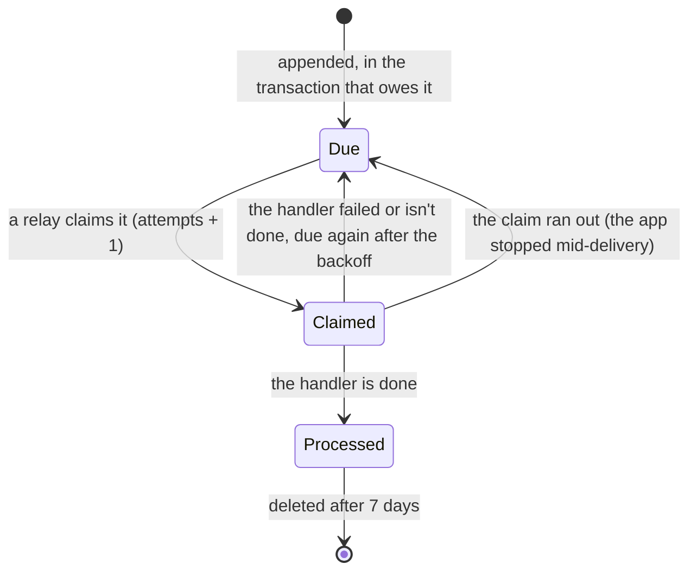

- At least once: a handler must be safe to repeat (check the record, same key).
- No transaction around a handler; claims use `FOR UPDATE SKIP LOCKED`.
- Retried with a backoff (10 s doubling to 10 min), never given up.

### Key decisions

| Decision | Why | Rejected alternative |
|---|---|---|
| One outbox and relay in `shop-common`, handlers in modules | One mechanism for every kind of owed work | A table and job per kind |
| Delivered in the app | One app, one database: no broker to run | Kafka or RabbitMQ |
| Messages name their record by id | Handlers read current state; nothing to version | A copied JSON payload |
| A claim moves `available_at` and commits | No connection held while a handler runs | Holding the row lock |
| At least once, idempotent handlers | Exactly once would need the provider in our transaction | Hoping no crash falls in between |
| After the commit, and also polled | Fast, and nothing lost on a crash | Only one of the two |

## 13. The checkout saga

A checkout is three steps that can't share one transaction. Each step that can be
undone has a compensation, and one orchestrator, `CheckoutSaga`, is told every
step's outcome in the transaction that records it, decides what follows, and keeps
each order's state in `checkout_saga` (`V19__checkout_saga.sql`).

| Step | Transaction | Compensation |
|---|---|---|
| 1. Book the order | `OrderService.placeOrder`: `PENDING`, stock reserved | cancel the order and restock |
| 2. Charge the payment | `PaymentService.pay`, at the provider | refund it: a cancellation's, or a late charge's (section 14) |
| 3. Confirm the order | `PaymentRecorder.recordSuccess`: `PAID` | none: the pivot |

### Orchestrated, not choreographed

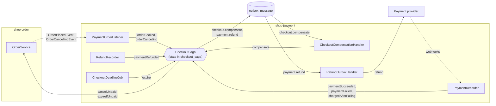

### The saga's states

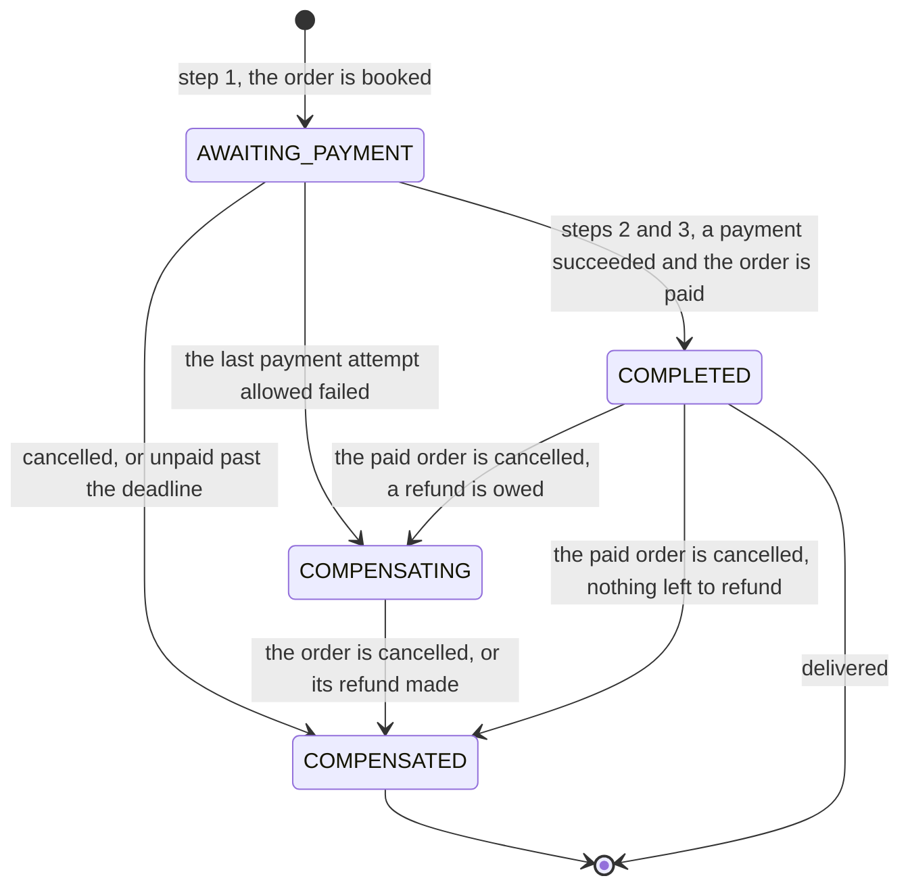

### The fifth failed payment

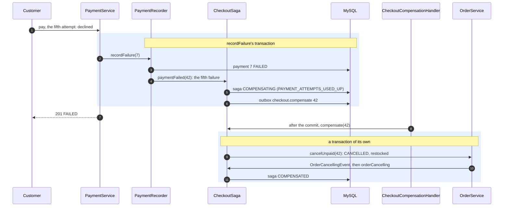

### What happens when

| Event | Told by | The saga | Compensation |
|---|---|---|---|
| An order is placed | `OrderPlacedEvent` | `AWAITING_PAYMENT` | |
| A payment succeeds | `recordSuccess` | `COMPLETED` | |
| The fifth payment fails | `recordFailure` | `COMPENSATING` | `checkout.compensate` message: cancel and restock |
| 30 minutes pass unpaid | `CheckoutDeadlineJob` | `COMPENSATED` | cancel and restock |
| An unpaid order is cancelled | `OrderCancellingEvent` | `COMPENSATED` | restock |
| A paid order is cancelled | `OrderCancellingEvent` | `COMPENSATING`, then `COMPENSATED` once refunded | refund what is left, restock |
| A charge arrives for a `FAILED` payment | `recordSuccess` (webhook) | unchanged | `LATE_CHARGE` refund of all of it (section 14) |
| Cancelling while a payment is `PROCESSING` | `OrderCancellingEvent` | refuses: `409` | none: step 2's outcome is unknown |

### Key decisions

| Decision | Why | Rejected alternative |
|---|---|---|
| Orchestration, one `CheckoutSaga` | The whole process in one class and one table | Choreography: modules reacting to events |
| The saga lives in `shop-payment` | It must call orders and payments, and only `shop-payment` may | A `shop-checkout` module above it |
| Confirming the order is the pivot | Once paid, a checkout only goes forward | Treating later changes as the checkout |
| The fifth failure's cancellation goes through the outbox | Recording a failure must not fail because cancelling did | Cancelling in the failure's transaction |
| The saga's row is locked last | It can't take part in a deadlock | Locking it first |

## 14. Charges after a failure

A payment recorded as `FAILED` could still be charged by the provider. Nothing is
left open where the shop can prevent it, and a charge that comes anyway is refunded
in full (`V20__late_charge_refunds.sql`).

- **Prevention:** a Stripe PaymentIntent the confirm leaves unfinished
  (`requires_action`, 3-D Secure) is cancelled before it is called declined; if the
  cancel is refused or fails, the payment stays `PROCESSING` for reconciliation.
- **Compensation:** the saga owes a `LATE_CHARGE` refund of all of it. The attempt
  stays `FAILED`, as the customer was told, and the order is still theirs to pay.

```mermaid
sequenceDiagram
    autonumber
    participant G as Provider
    participant W as PaymentWebhookProcessor
    participant R as PaymentRecorder
    participant S as CheckoutSaga
    participant DB as MySQL
    participant O as OutboxRelay
    G->>W: charge.succeeded for pay_7, signed
    rect rgb(230, 240, 255)
    note over W,DB: the webhook's transaction
    W->>DB: record event evt_… (exactly once, section 7)
    W->>R: recordSuccess(7)
    R->>DB: lock payment 7: it is FAILED
    R->>S: chargedAfterFailing(7)
    S->>DB: payment 7 gets late_charged_at and the charge's reference, stays FAILED
    S->>DB: INSERT refund 12 (LATE_CHARGE, all of it, PENDING)
    S->>DB: outbox payment.refund 12
    end
    O->>G: refund(key rfd_…), after the commit, no transaction open
    O->>DB: refund 12 REFUNDED, payment 7 still FAILED
```

### Key decisions

| Decision | Why | Rejected alternative |
|---|---|---|
| Cancel an unfinished PaymentIntent before calling it declined | Nothing called failed can charge later | Relying on the refund alone |
| Refund the late charge in full, always | Right whether the customer paid again or not | Taking it as the order's payment |
| The attempt stays `FAILED`, with `late_charged_at` | The customer's record and V11's index stay true | A new payment status |
| Reuse the refund table, outbox and refund webhook | One way money goes back | A table and sender of its own |

Try it with the `test_late_charge` card: declined, then refunded a few seconds
later (`late-charge.e2e.ts`).

## 15. Roadmap

```mermaid
flowchart TB
    subgraph R1["Payments: phases 1 to 3"]
        direction LR
        A["Payments<br/>§1–3 · PR 177"] --> B["Refunds, reconciliation,<br/>unpaid expiry<br/>§4–6 · PR 178–180"] --> C["Signed webhooks<br/>§7 · PR 181"] --> D["Stripe test mode, breaker,<br/>retries and fallbacks<br/>§8–10 · PR 185, 187, 188"]
    end
    subgraph R2["Money going back, and consistency"]
        direction LR
        E["Partial refunds<br/>§11 · PR 189, 190"] --> F["Transactional outbox<br/>§12 · PR 218"] --> G["Checkout saga<br/>§13 · PR 219"] --> H["Charges after a failure<br/>§14 · PR 221"]
    end
    subgraph R3["Next"]
        direction LR
        N["Stripe Elements in the browser,<br/>with 3-D Secure"]
    end
    R1 --> R2 --> R3
    classDef done stroke:#1a7f37,stroke-width:2px
    classDef next stroke:#9a6700,stroke-width:2px,stroke-dasharray: 5 5
    class A,B,C,D,E,F,G,H done
    class N next
```
