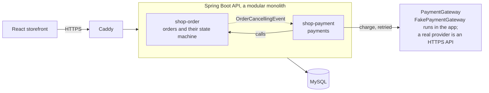
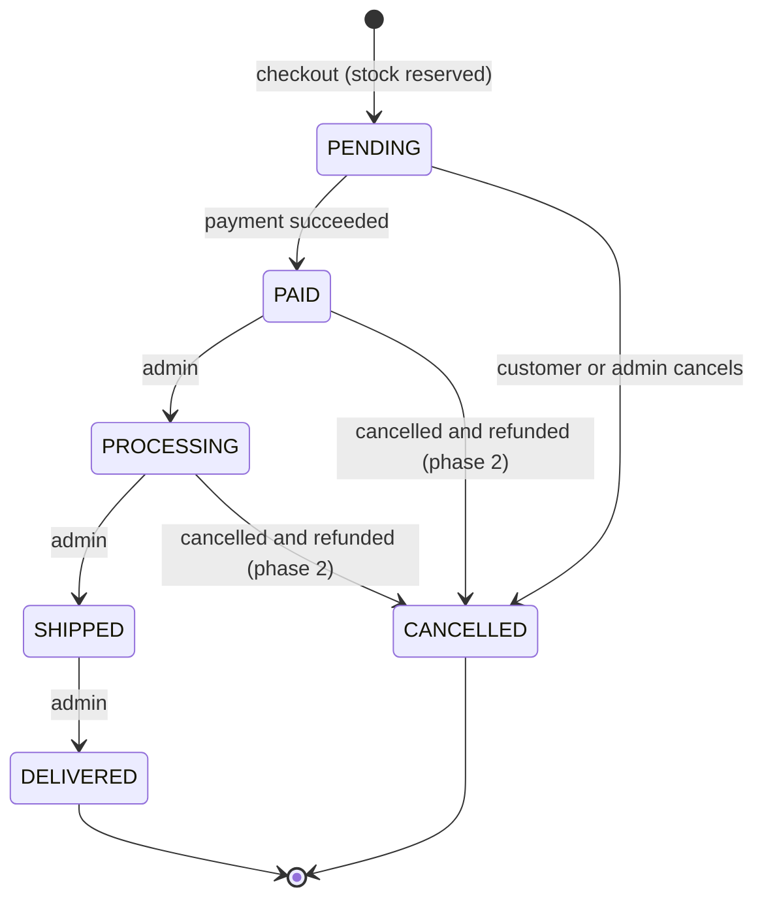
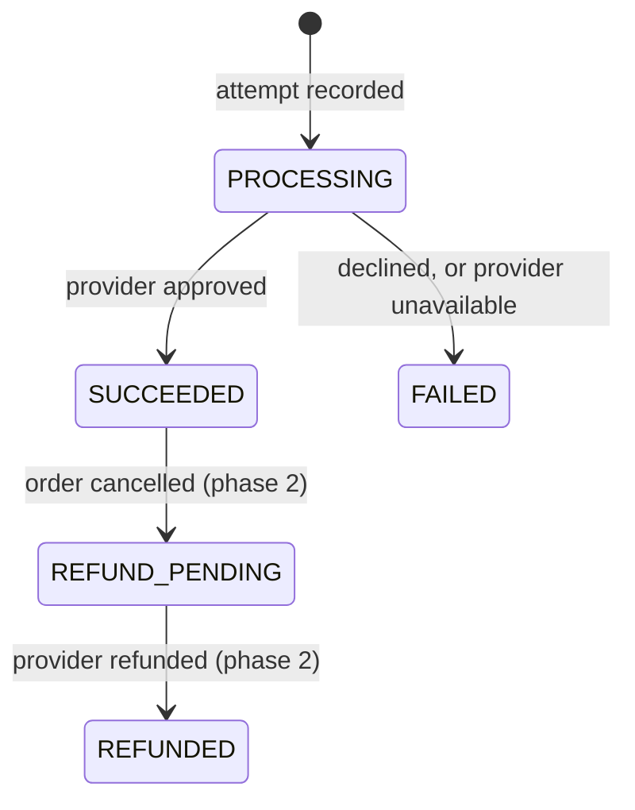
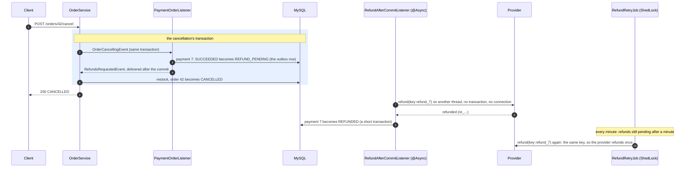
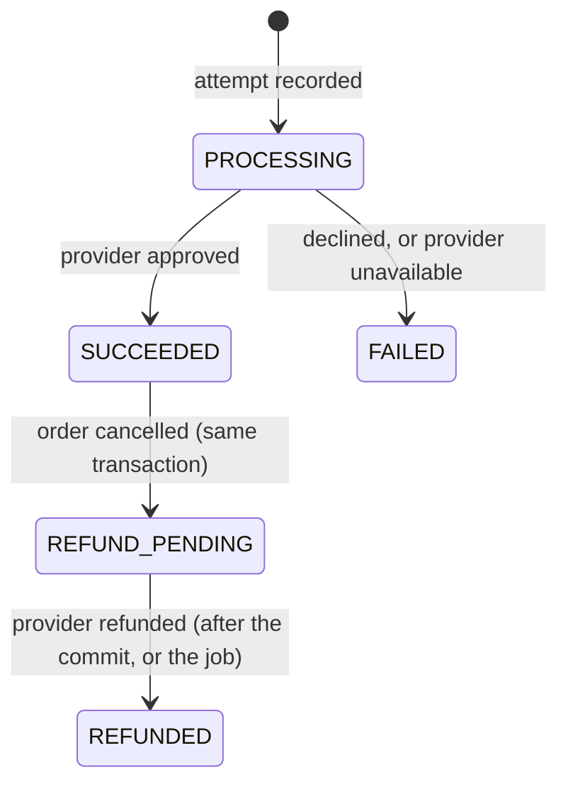
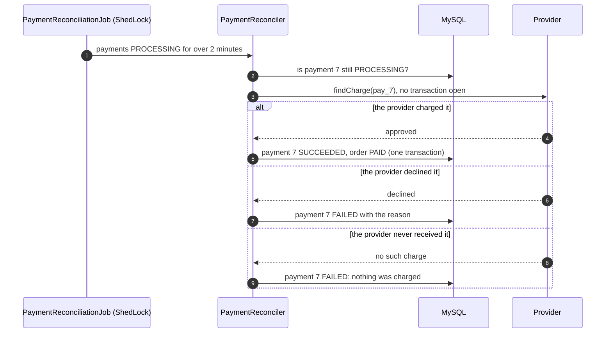

# Payment service design

This is a portfolio project, so the money is simulated. There is no real payment
provider and no card data: a fake provider inside the app stands in for one (much
like a provider's test mode), behind the same interface a real provider would sit
behind. Everything around it (the transactions, idempotency, locking and failure
handling) is built the way a real payment flow needs it.

## 1. Requirements

### What it must do

| # | Requirement | Phase |
|---|---|---|
| F1 | A customer pays for their own order while it is `PENDING`. The amount is the order's total, worked out by the server. | 1 |
| F2 | They pay with a test payment method (`test_visa`, `test_declined`, ...), which stands in for the token a provider's card form returns. The server never sees a card number. | 1 |
| F3 | Paying twice by accident (a double click, a request retried after a timeout) charges once and returns the first result. | 1 |
| F4 | A declined payment leaves the order `PENDING`, and the customer can try another method, up to 5 failed attempts per order. | 1 |
| F5 | A successful payment moves the order to `PAID`. Only then can the shop fulfil it (`PROCESSING`, `SHIPPED`, `DELIVERED`). | 1 |
| F6 | The customer and admins can see an order's payment attempts. | 1 |
| F7 | Cancelling a paid order refunds it in full. | 2 |
| F8 | An order left unpaid for 30 minutes is cancelled and its stock returned. | 2 |
| F9 | A payment whose outcome is unknown (the provider timed out) is settled later by asking the provider. | 2 |

### How well it must do it

- **No double charge, no lost payment, and no charge kept for a cancelled order**,
  with concurrent requests and with a failure at any step.
- **No provider call inside a database transaction.** A transaction holds one of
  the pool's 10 connections until it ends, and a rollback can't undo a charge.
- **Atomic money state.** A payment and its order change together or not at all.
- **Security.** Only the order's owner (or an admin) can pay for it or see its
  payments, the client never sends the amount, and no card data is stored.
- **Audit.** Payment rows are never deleted, and a settled payment's outcome never
  changes; every attempt is kept.

### Out of scope

Real providers and card data (PCI DSS), partial refunds, several currencies, saved
cards, 3-D Secure and payouts.

## 2. High-level design

### Components



- `shop-payment` is a new module that depends on `shop-order` (and on
  `shop-identity` and `shop-common`). Orders never call payments: when orders are
  being cancelled, `shop-order` publishes an `OrderCancellingEvent` that
  `shop-payment` handles inside the same transaction, the way `UserDeletingEvent`
  already works.
- `PaymentGateway` is the boundary with the provider. `FakePaymentGateway`
  implements it inside the app; a real provider would be another implementation,
  with its API key coming only from an environment variable.

### Order lifecycle (changed)



Only a successful payment moves an order to `PAID`; an admin can't set it by hand.
Phase 1 couldn't cancel a paid order, since nothing could give the money back;
phase 2 refunds it (section 4).

### Payment lifecycle



### API

| Method | Path | Who | Result |
|---|---|---|---|
| `POST` | `/api/v1/orders/{orderId}/payments` | the order's owner or an admin | `201` with the new payment (`SUCCEEDED` or `FAILED`); `202` with it `PROCESSING` when the provider didn't answer in time (section 5); `200` with the stored payment when the `Idempotency-Key` was already used for this order |
| `GET` | `/api/v1/orders/{orderId}/payments` | owner or admin | the order's attempts, oldest first (at most 5, so not paginated) |
| `GET` | `/api/v1/orders/{orderId}/payments/{paymentId}` | owner or admin | one attempt |

`POST` takes an `Idempotency-Key` header (8 to 64 letters, digits, `-` or `_`; the
storefront sends a new UUID for each attempt) and a body like
`{"paymentMethod": "test_visa"}`.

### The pay flow: three short steps, and no provider call inside a transaction

```mermaid
sequenceDiagram
    autonumber
    participant C as Client
    participant S as PaymentService (no transaction)
    participant R as PaymentRecorder
    participant DB as MySQL
    participant G as PaymentGatewayClient (@Retryable)
    C->>S: POST /orders/42/payments, Idempotency-Key k1
    S->>R: start(42, k1, test_visa)
    rect rgb(230, 240, 255)
    note over R,DB: transaction 1 (milliseconds)
    R->>DB: lock order 42 (SELECT ... FOR UPDATE)
    R->>DB: a payment with key k1 for order 42? none
    R->>DB: raise order 42's version, INSERT payment 7 (PROCESSING, amount = order total)
    end
    S->>G: charge(provider key pay_7, amount, test_visa)
    note over G: no transaction and no connection held;<br/>retried with the same key if the provider is unavailable
    G-->>S: approved (reference, Visa 4242)
    S->>R: recordSuccess(7, ...)
    rect rgb(230, 240, 255)
    note over R,DB: transaction 2 (milliseconds)
    R->>DB: payment 7 becomes SUCCEEDED
    R->>DB: order 42 becomes PAID
    end
    S-->>C: 201 Created, status SUCCEEDED
```

If the app dies between the steps, the payment stays `PROCESSING`. That blocks
another payment and a cancellation of the order until it is settled, so the order
can't be charged twice, or charged and cancelled. Phase 2's reconciliation job asks
the provider about it (by the same key) and finishes it.

### Key decisions

| Decision | Why | Rejected alternative |
|---|---|---|
| Record the attempt, call the provider, record the result: three steps, two short transactions | A provider call can take seconds. Inside a transaction it would hold a pooled connection that long, and a rollback can't undo a charge anyway | One `@Transactional` method around all of it |
| The client sends an `Idempotency-Key`, unique per order in the database, and a repeat returns the stored payment | After a timeout the client can't tell a lost request from a lost response, so it must be able to send the request again safely | Spotting duplicates by amount and time (guesswork) |
| The provider gets a key of our own, `pay_<payment id>`, on every call and retry of an attempt | The provider deduplicates retries of one attempt, and keys chosen by different clients can never collide there | Passing the client's key on |
| The order row is locked (`SELECT ... FOR UPDATE`) while an attempt starts, and a new attempt raises the order's version | Two attempts for one order run one after the other, and the raised version makes a cancellation running at the same time fail instead of slipping in between | Optimistic checks only: both attempts could pass them |
| At most one payment that isn't `FAILED` per order, enforced by a unique index on a generated column | The rule holds even if some code path forgets the lock | Trusting the service code alone |
| Cancelling an order whose payment is `PROCESSING` is refused (`409`) | The charge may still go through, and cancelling would then keep money for a cancelled order | Cancelling now and refunding later |
| Retry only "provider unavailable", in a separate bean, outside any transaction, with the same provider key | A retry must not repeat database writes, and the key makes the repeated call safe (CLAUDE.md, retries rule) | `@Retryable` on a `@Transactional` method |
| A decline is a result, not an error: `201` with status `FAILED` | The attempt happened and is recorded; the storefront shows the reason and offers another method | An error response that leaves no record |
| At most 5 failed attempts per order | Stops card testing (trying stolen card numbers one after another) and bounds the attempt list | No limit |
| The amount is copied from the order, as `BigDecimal` and `DECIMAL(38,2)`, in a currency set by the server | Floating point loses cents, and the client never decides the price | An amount sent by the client |

## 3. Low-level design

### Classes

In `shop-payment`, package `com.aryan.spring_security_demo.payment`:

| Class | Role | Transaction |
|---|---|---|
| `PaymentController` | The endpoints; validates the `Idempotency-Key` and the body | none |
| `PaymentService` | Runs the three steps of a payment; reads | none for `pay`, read-only for reads |
| `PaymentRecorder` | `start`, `recordSuccess`, `recordFailure` | each a short `@Transactional` of its own (a separate bean, so the proxy applies) |
| `PaymentGatewayClient` | Calls the gateway, `@Retryable` on `PaymentProviderUnavailableException` (2 retries, after 100 ms and 200 ms) | none, by design |
| `PaymentGateway` | The provider boundary: `charge(ChargeRequest)` returns a `ChargeResult` (`Approved` or `Declined`), or throws `PaymentProviderUnavailableException` | |
| `FakePaymentGateway` | The test payment methods below; remembers each result by provider key, so a repeated key gets the first result | |
| `Payment`, `PaymentStatus`, `PaymentRepository` | The entity, its state machine and its queries | |
| `PaymentOrderListener` | Refuses to cancel an order while one of its payments is `PROCESSING` | joins the cancellation's transaction (`MANDATORY`) |

Changes in `shop-order`:
- `OrderStatus` gets `PAID`.
- `OrderService.lockForPayment` (lock the order and check the caller owns it),
  `startPayment` (raise the locked order's version, for a new attempt only) and
  `markPaid` (`PENDING` to `PAID`, read under a lock). All three require the
  caller's transaction (`MANDATORY`).
- `updateStatus` refuses `PAID`.
- Cancelling orders publishes an `OrderCancellingEvent`.

### Test payment methods

| Method | Result |
|---|---|
| `test_visa` | approved, Visa ending in 4242 |
| `test_mastercard` | approved, Mastercard ending in 4444 |
| `test_declined` | declined: "Your card was declined." |
| `test_insufficient_funds` | declined: "Your card has insufficient funds." |
| `test_flaky` | provider unavailable on the first try of each charge, approved on the retry |
| `test_provider_down` | provider unavailable every time, so `FAILED` once the retries run out |
| anything else | declined: "Unknown payment method." |

### Data model (`V11__payments.sql`)

```sql
create table payment (
    id                 bigint not null auto_increment,
    version            bigint not null,
    order_id           bigint not null,
    idempotency_key    varchar(64) not null,
    payment_method     varchar(64) not null,
    amount             decimal(38,2) not null,
    currency           varchar(3) not null,
    status             enum ('FAILED','PROCESSING','SUCCEEDED') not null,
    provider_reference varchar(64),
    card_brand         varchar(20),
    card_last4         varchar(4),
    failure_reason     varchar(255),
    created_at         datetime(6) not null,
    completed_at       datetime(6),
    -- The order's id unless the payment FAILED, else null; a unique index ignores nulls.
    live_order_id      bigint generated always as (case when status <> 'FAILED' then order_id end) stored,
    primary key (id),
    constraint uk_payment_order_idempotency_key unique (order_id, idempotency_key),
    constraint uk_payment_live_order unique (live_order_id),
    constraint uk_payment_provider_reference unique (provider_reference),
    constraint chk_payment_amount_positive check (amount > 0),
    constraint fk_payment_order foreign key (order_id) references orders (id)
) engine=InnoDB;
```

`orders.order_status` gets `PAID`. Orders are never deleted (deleting an account
only unlinks them), so the foreign key needs no `on delete` rule.

### What happens when

| Situation | Result |
|---|---|
| The same key and method again, for the same order | `200` with the stored payment, even while it is still `PROCESSING` |
| The same key with another method | `409`, key reused |
| The order isn't `PENDING` (paid, cancelled, ...) | `409` |
| Another payment of the order is `PROCESSING` | `409` |
| 5 failed attempts already | `409` |
| Someone else's order | `403`; an order that doesn't exist, `404` |
| `Idempotency-Key` missing or malformed, or no payment method | `400` |
| Declined | `201` with status `FAILED` and the reason; the order stays `PENDING` |
| Provider still unavailable after the retries | `201`, `FAILED`, "payment provider unavailable". Safe, because an unavailable provider never took the charge |
| Cancelling while a payment is `PROCESSING` | `409` |
| An admin sets the status to `PAID` | `409` |

### Concurrency

| Race | What prevents the bug | Integration test checks |
|---|---|---|
| Double click: the same key twice at once | The order lock makes them take turns, and the second finds the first's payment and returns it | one charge, one payment id |
| Two tabs: different keys at once | The order lock; the second then sees a payment in progress or an order no longer pending. The unique `live_order_id` is the backstop | exactly one `SUCCEEDED` payment and one charge |
| Paying and cancelling at once | The lock and version bump: a cancellation that read the order before the attempt started fails its version check, and one that reads it after sees the `PROCESSING` payment and is refused | never `CANCELLED` with a `SUCCEEDED` payment |
| The provider call and the connection pool | No transaction is open during the call | a spy on the gateway sees no active transaction |

**A bug the double-click test caught.** The first version raised the order's
version whenever it locked the order, including for a repeated request. That
repeat committed its raised version while the first request was still waiting
for the provider, so the first request's "record the result" transaction failed
its version check: the card was charged, the payment stayed `PROCESSING`, and the
customer got a `409`. Now only a new attempt raises the version (a repeat starts
nothing, so it has no cancellation to fence off), and `markPaid` reads the order
under a lock, so recording a result always works from the latest version.

## 4. Phase 2: refunds

Cancelling a paid order (by the customer, an admin, or deleting the account) now
refunds it in full. The refund has to survive two things a transaction can't
cover: a provider that is down, and the app stopping between the cancellation and
the refund call.

### The flow: an outbox row, then the provider after the commit



- **The outbox row is written in the cancellation's transaction.** The order
  becoming `CANCELLED` and the payment becoming `REFUND_PENDING` commit together or
  not at all, so a cancelled order always has a record that money is owed back,
  even if the app stops a moment later.
- **The provider is called only after the commit.** Calling it inside the
  transaction would hold a pooled connection, and if the transaction then rolled
  back, the customer would be refunded for an order that wasn't cancelled.
- **The after-commit listener runs `@Async`.** Spring runs an `AFTER_COMMIT`
  listener *before* it releases the transaction's connection and unbinds its
  resources (`AbstractPlatformTransactionManager.processCommit`: `doCommit`, then
  `triggerAfterCommit`, then `cleanupAfterCompletion`). A provider call made right
  there would hold the request's connection for as long as it takes. A
  `@Transactional` method called from there would also join the transaction that
  has already committed, and its writes would be silently lost. On a background
  thread there is neither problem, and the cancel request doesn't wait for the
  provider.
- **The recorder's refund methods are `REQUIRES_NEW`.** On the background thread or
  in the job, that is simply a new transaction; if the listener were ever made
  synchronous again, it would still keep the write out of the committed one.
- **The listener catches every failure and leaves the row pending.** The
  transaction has committed by then, so there is nothing left to roll back;
  `RefundRetryJob` retries every refund still pending a minute after it was
  requested (one instance at a time, through ShedLock).
- **Every call for one refund uses the key `refund_<payment id>`.** The listener,
  its retries and the job can all reach the provider for the same refund, and the
  provider refunds it once. Recording an outcome that is already recorded does
  nothing.

### Payment lifecycle, completed



The charge's own facts (amount, provider reference, card) never change; a refund
adds its own reference and times. `V12__payment_refunds.sql` adds the two statuses,
`refund_reference` (unique), `refund_requested_at` and `refunded_at`, and an index
for the job's query.

### What happens when

| Situation | Result |
|---|---|
| A paid (or processing) order is cancelled | `200`, order `CANCELLED`, stock returned, payment `REFUND_PENDING`, then `REFUNDED` a moment later |
| The provider is down when the refund is first tried | The payment stays `REFUND_PENDING`; the job refunds it once the provider is back |
| The app stops right after the cancellation commits | The row is `REFUND_PENDING`; the job finds it on the next run |
| The listener and the job reach the provider for one refund | The same key: refunded once, recorded once |
| An unpaid order is cancelled | No payment to refund; as before |
| An order whose payment is `PROCESSING` is cancelled | `409`, as before: the charge may still go through |

A new test method, `test_refund_down`, charges normally, but the provider fails the
first 3 refund calls (the first try and its 2 retries), so the job's later attempt
is the one that succeeds.

## 5. Phase 2: reconciliation

A payment is recorded as `PROCESSING` before the provider is called, and settled
after. If the settling never happens, it stays `PROCESSING`, and its order can be
neither paid again nor cancelled. Three things can cause that:

- **The provider times out** after the request was sent: it may or may not have
  charged.
- **The app stops** between the provider's answer and recording it.
- **Recording the answer fails** (the database is briefly unreachable) after the
  provider approved.

In every case the provider knows what happened. Reconciliation asks it.



- **The provider is the source of truth.** The payment's key, `pay_<payment id>`,
  is what the charge was sent under, so the provider can say exactly what happened
  to that attempt. If the provider is unavailable, the payment stays `PROCESSING`
  until the next run.
- **Only after 2 minutes.** A request may still be waiting on the provider; 2
  minutes is well past any request's provider timeout, so the job never settles an
  attempt the request is still settling. If both get there anyway, they settle it
  from the same answer, and recording an outcome that is already recorded does
  nothing.
- **A timeout is answered, not failed.** A timed-out charge isn't retried inside
  the request (each try could take the full timeout, holding the customer's
  request) and isn't marked failed (it may have charged). The request answers
  `202 Accepted` with the payment `PROCESSING`; the storefront shows that the
  payment is being confirmed, and updates once the job settles it.
- **"Never received" is safe to fail** only because of the 2 minutes: by then a
  request that hasn't reached the provider never will.

Two new test methods make the cases reproducible: `test_timeout_charged` (the
provider charges, and then the answer is lost) and `test_timeout_not_charged` (the
request never reaches the provider). Like the fake provider's other answers, what
it charged is kept in memory, so after a restart it reports every earlier charge as
never received; a real provider remembers.

No new columns: the job's query (`status = 'PROCESSING' and created_at < ?`) uses
the `status`-led index from `V12`.

## 6. Phase 2: unpaid order expiry

Checkout takes the items out of stock straight away, so an order nobody pays for
holds them forever. An order still `PENDING` 30 minutes after it was placed
(`app.orders.unpaid-expiry`) is cancelled, and its items go back on sale.

- **The order module owns it.** `UnpaidOrderExpiryJob` (ShedLock, every minute)
  finds the unpaid orders placed before the cutoff, and cancels each through
  `OrderService.expireIfUnpaid`: the same cancellation as the customer's (restock
  under product locks, `OrderCancellingEvent`), without the ownership check.
- **One transaction per order.** The job calls a public `@Transactional` method on
  another bean, so each order goes through Spring's proxy and commits or rolls back
  alone, and holds its product locks only as long as its own cancellation. The
  order's status and age are checked again inside that transaction: it may have
  been paid since the scan.
- **Payments still have a say.** An order with a payment `PROCESSING` may still be
  charged, so the payment module refuses its cancellation (`409`). The job leaves
  that order and tries again on a later run, after reconciliation (section 5) has
  settled the payment.
- **Paying at the last second is safe.** A new payment attempt raises the order's
  version, so an expiry that read the order before fails its version check; an
  expiry that commits first leaves the order `CANCELLED`, and the payment request
  gets a `409`. Either way the order is never cancelled with money taken.
- **The customer is told.** While an order is unpaid, the API returns `payBy` (when
  it was placed plus the window), and the order page says "Pay by ...".

`V13__orders_status_created_index.sql` adds `(order_status, created_at)` for the
job's query; the existing index leads with `user_id`.

## 7. Roadmap

- **Phase 1:** everything in sections 1 to 3, the pay step on the storefront's
  order page, and tests (unit, integration against MySQL, end-to-end).
- **Phase 2:** refunds when a paid order is cancelled (section 4), reconciliation of
  payments stuck in `PROCESSING` (section 5), and expiry of orders left unpaid
  (section 6).
- **Phase 3:** provider webhooks with a signature check, and an adapter for a real
  provider's test mode.
