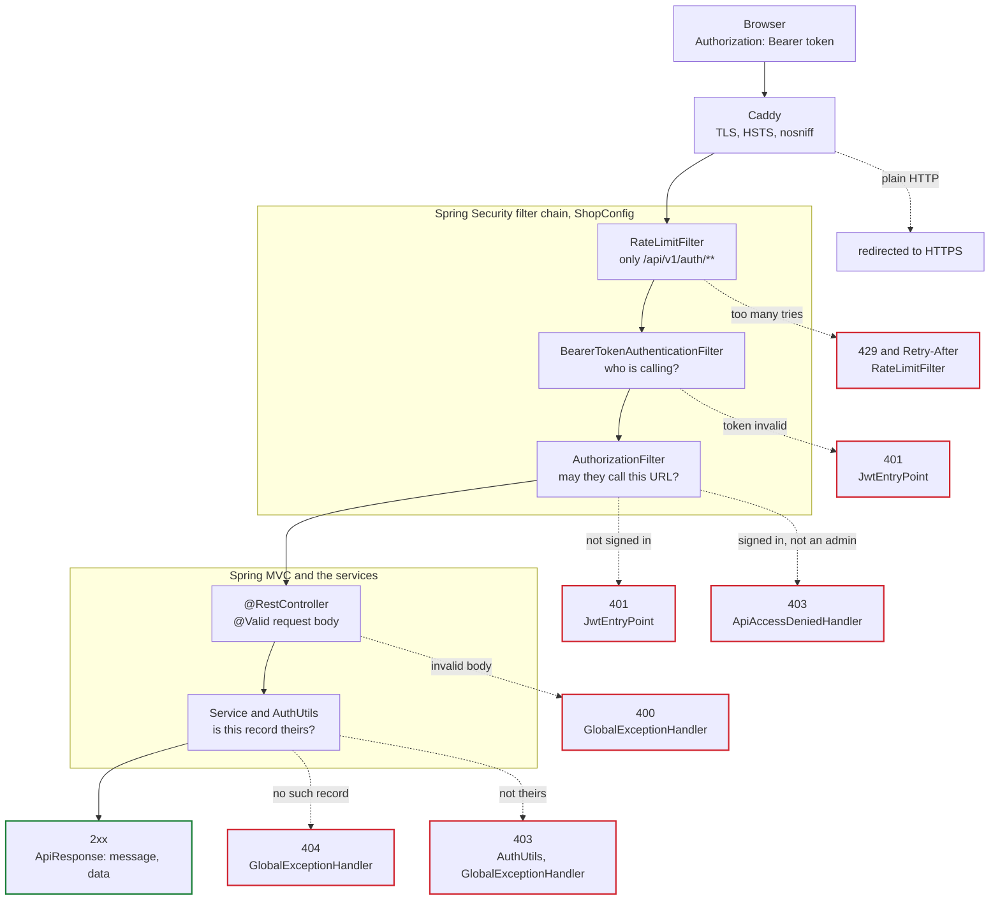
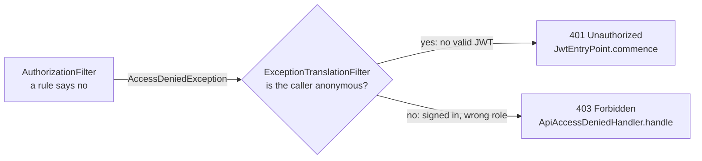
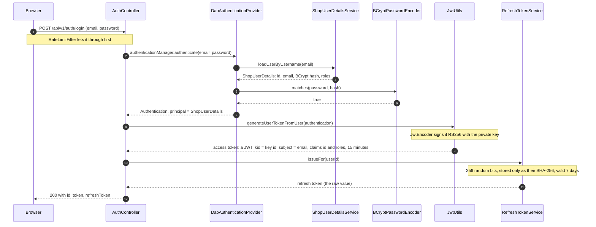
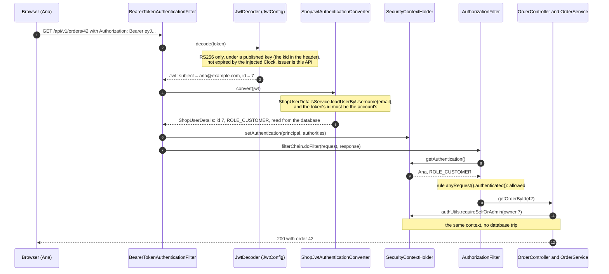
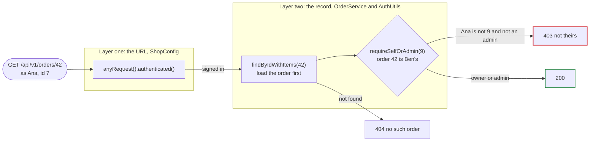
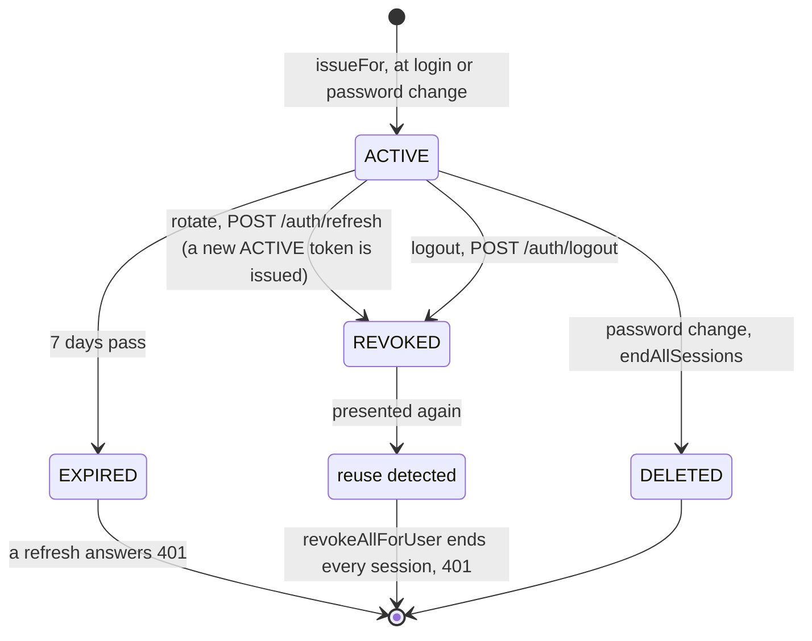
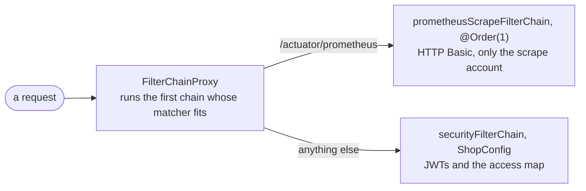
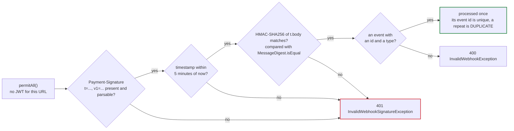
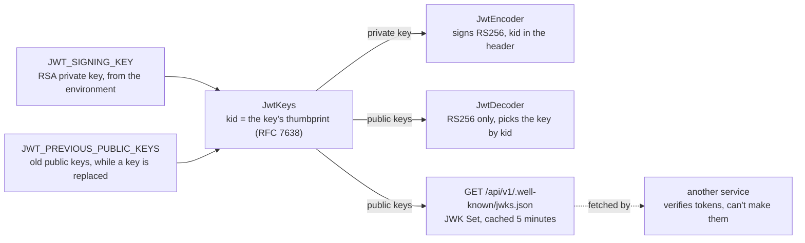

# Security design

How the API decides who is calling and what they may do, drawn from the classes
that do it. Each section names the classes and methods involved, and ends with links
to them, so a diagram can be read next to its code. The diagrams are
[Mermaid](https://mermaid.js.org/), which GitHub draws in place.

The access token is a JWT signed RS256 with an RSA private key that only this
application holds. It is checked with the public key, through Spring Security's
resource-server support, and the public key is published (section 14), so another
service can check a token without being able to make one.

## 1. The road a request travels

Every request passes a row of checks, and each one can answer no. The solid arrows
are a request that gets through; each dotted one is a place it can stop, with the
status code it gets and the class that writes the answer.

- `BearerTokenAuthenticationFilter` is Spring Security's: `oauth2ResourceServer()`
  in `ShopConfig` adds it. With no token the caller stays anonymous, and the decision
  is left to `AuthorizationFilter`. A token that fails its checks is a `401` on any
  URL, public ones too, as RFC 6750 has it.
- `RateLimitFilter` is placed before it in `ShopConfig`:
  `addFilterBefore(rateLimitFilter, BearerTokenAuthenticationFilter.class)`.
- Errors raised inside the filter chain never reach `GlobalExceptionHandler`, which
  only sees exceptions thrown inside Spring MVC. So `JwtEntryPoint`,
  `ApiAccessDeniedHandler` and `RateLimitFilter` write their answers themselves, as
  the same RFC 7807 problem JSON.

### Spring Security's pieces, and this application's class for each

| Spring Security piece | Its job | Here |
|---|---|---|
| `SecurityFilterChain` | The filters and URL rules a request goes through | `ShopConfig.securityFilterChain`, and a second chain for Prometheus (section 10) |
| `BearerTokenAuthenticationFilter` | Reads the bearer token and authenticates the request with it | Spring's own, added by `oauth2ResourceServer()` in `ShopConfig` |
| `JwtDecoder`, `JwtEncoder` | Check a JWT's signature and claims; sign a new one | `NimbusJwtDecoder` and `NimbusJwtEncoder`, beans in `JwtConfig`, with the keys from `JwtKeys` |
| `Converter<Jwt, AbstractAuthenticationToken>` | Turns a verified token into the caller | `ShopJwtAuthenticationConverter`, which loads the user |
| `OncePerRequestFilter` | Base class for a filter that runs once per request | `RateLimitFilter` |
| `UserDetailsService` | Finds a user by username, for Spring to check | `ShopUserDetailsService`; the username is the email |
| `UserDetails` | The user as Spring sees it: name, password hash, authorities | `ShopUserDetails`, which also carries the user's id |
| `AuthenticationManager`, `DaoAuthenticationProvider` | Check a username and password with the pieces above and below | Beans in `ShopConfig`, called by `AuthController.login` |
| `PasswordEncoder` | Hashes passwords and compares them | `BCryptPasswordEncoder`, a bean in `ShopConfig` |
| `SecurityContextHolder` | Holds who is calling, for the rest of the request | Filled by `BearerTokenAuthenticationFilter`, read by `AuthUtils` |
| `AuthenticationEntryPoint` | Answers when the caller must sign in | `JwtEntryPoint` (401) |
| `AccessDeniedHandler` | Answers when a signed-in caller isn't allowed | `ApiAccessDeniedHandler` (403) |
| `CorsConfigurationSource` | Which other websites may call the API from a browser | `CorsConfig` |

Code: [`ShopConfig`](../shop-identity/src/main/java/com/aryan/spring_security_demo/identity/security/config/ShopConfig.java),
[`GlobalExceptionHandler`](../shop-common/src/main/java/com/aryan/spring_security_demo/common/exception/GlobalExceptionHandler.java).

## 2. 401 or 403?

When a URL rule refuses a request, `AuthorizationFilter` throws an
`AccessDeniedException`. Spring's `ExceptionTranslationFilter`, which runs just
before it, catches the exception and asks one question.

Code: [`JwtEntryPoint`](../shop-identity/src/main/java/com/aryan/spring_security_demo/identity/security/jwt/JwtEntryPoint.java),
[`ApiAccessDeniedHandler`](../shop-identity/src/main/java/com/aryan/spring_security_demo/identity/security/ApiAccessDeniedHandler.java),
and `exceptionHandling(...)` in `ShopConfig`.

## 3. Signing in

Login is the only place a password is checked. `AuthController` doesn't check it
itself: it hands the email and password to Spring's `AuthenticationManager`, which
uses the `DaoAuthenticationProvider` that `ShopConfig` builds. That provider needs
two things from this application: a `UserDetailsService` to find the user, and a
`PasswordEncoder` to compare the password with the stored hash.

If the email is unknown or the password wrong, the provider throws
`BadCredentialsException` and `GlobalExceptionHandler` answers `401` "Invalid email
or password". `ShopUserDetailsService` throws Spring's `UsernameNotFoundException`
for an unknown email on purpose: the provider turns it into the same
`BadCredentialsException`, so the answer can't be used to find out which emails
have accounts.

Code: [`AuthController.login`](../shop-identity/src/main/java/com/aryan/spring_security_demo/identity/AuthController.java),
[`ShopUserDetailsService`](../shop-identity/src/main/java/com/aryan/spring_security_demo/identity/security/user/ShopUserDetailsService.java),
[`JwtUtils.generateTokenFromUserDetails`](../shop-identity/src/main/java/com/aryan/spring_security_demo/identity/security/jwt/JwtUtils.java),
[`JwtConfig`](../shop-identity/src/main/java/com/aryan/spring_security_demo/identity/security/jwt/JwtConfig.java),
[`RefreshTokenService.issueFor`](../shop-identity/src/main/java/com/aryan/spring_security_demo/identity/RefreshTokenService.java).

## 4. Every request after that

There is no server-side session: `ShopConfig` sets the session policy to
`STATELESS`. Each request carries the access token, and Spring Security's
resource-server support rebuilds the caller from it every time.

- The roles inside the JWT aren't used for decisions. The converter reloads the user
  from the database on every request, so a deleted account or a removed role takes
  effect on the next request, not when the token expires. The roles are in the token
  for other services that read it.
- The token must also name the account's current id. If an account is deleted and
  its email signs up again, a token made for the first account doesn't work for the
  second.
- No token at all leaves the caller anonymous. An expired, forged or otherwise
  invalid one is refused by `BearerTokenAuthenticationFilter` with a `401` from
  `JwtEntryPoint`, with `WWW-Authenticate: Bearer`, whatever the URL. The storefront
  sends no token to the public catalogue, so this only reaches clients that send one.

Code: `oauth2ResourceServer(...)` in `ShopConfig`,
[`JwtConfig.jwtDecoder`](../shop-identity/src/main/java/com/aryan/spring_security_demo/identity/security/jwt/JwtConfig.java),
[`ShopJwtAuthenticationConverter`](../shop-identity/src/main/java/com/aryan/spring_security_demo/identity/security/jwt/ShopJwtAuthenticationConverter.java),
[`AuthUtils`](../shop-identity/src/main/java/com/aryan/spring_security_demo/identity/security/AuthUtils.java).

## 5. The access map

All URL rules live in one method, `ShopConfig.securityFilterChain`. Spring checks
them from the top and uses the first that matches, so their order matters: the
password-change rule has to come before the `/auth/**` permitAll, or it would be
open to anyone.

| # | Method | Path | Rule | Why |
|---|---|---|---|---|
| 1 | `PUT` | `/api/v1/auth/password` | authenticated | The one `/auth` endpoint that needs a signed-in caller; under `/auth` so it is rate-limited like login |
| 2 | any | `/api/v1/auth/**` | permitAll | Login, refresh, logout: the caller has no token yet |
| 3 | `POST` | `/api/v1/users` | permitAll | Signing up |
| 4 | `GET` | `/api/v1/.well-known/jwks.json` | permitAll | The public keys that verify tokens (section 14); nothing can be signed with them |
| 5 | `POST` | `/api/v1/payments/webhooks` | permitAll | The payment provider has no user token; its HMAC signature authenticates it instead (section 10) |
| 6 | `GET` | `/products/**`, `/categories/**`, `/images/**` | permitAll | Browsing the catalogue |
| 7 | any | `/swagger-ui/**`, `/v3/api-docs/**` | permitAll | API docs; the `prod` profile turns them off |
| 8 | any | actuator `health` | permitAll | Load balancers probe it; only admins see its details |
| 9 | any | every other actuator endpoint | `ROLE_ADMIN` | Metrics and build information are for operators |
| 10 | any | `/error` | permitAll | So an error can be shown |
| 11 | `POST`, `PUT`, `DELETE` | `/products/**`, `/categories/**`, `/images/**` | `ROLE_ADMIN` | Changing the catalogue |
| 12 | `PATCH` | `/api/v1/orders/*/status` | `ROLE_ADMIN` | Shipping and delivering; cancelling is a customer's action, checked in the service |
| 13 | `GET` | `/api/v1/orders/admin` | `ROLE_ADMIN` | Every customer's orders; without this rule any signed-in user could list them |
| 14 | `POST` | `/api/v1/orders/*/refunds` | `ROLE_ADMIN` | A refund gives money back, so an admin decides |
| 15 | any | everything else | authenticated | Deny by default: a new endpoint is never public by accident; the service then checks ownership |

Admin rules use `hasAuthority("ROLE_ADMIN")` here rather than `@PreAuthorize` on the
controllers, so the whole map can be read in one place. Rows 8 and 9 match the
actuator endpoints themselves (`EndpointRequest`), so they keep working if the
actuator's path or port changes.

## 6. Is this record theirs?

The access map knows only URLs and roles. It can't know that order 42 belongs to
Ben. That check happens in the service, once the record is loaded, through
`AuthUtils`. Without it, any signed-in user could read anyone's order by guessing its
id (an insecure direct object reference, IDOR).

- The order is looked up before the owner is compared, so an id that doesn't exist
  is a `404` and only a real order can be a `403`.
- An order whose account was deleted has no owner, and `requireSelfOrAdmin(null)`
  refuses everyone but admins.
- The other way to do it is to query only the caller's rows, with
  `authUtils.currentUserId()` in the query, as the wishlist, the notifications and
  "my cart" do. Then there is nothing to compare: someone else's rows are never
  loaded.

Code: `OrderService.getOrder` in
[`OrderService`](../shop-order/src/main/java/com/aryan/spring_security_demo/order/OrderService.java),
[`CartService`](../shop-cart/src/main/java/com/aryan/spring_security_demo/cart/CartService.java),
[`WishlistService`](../shop-wishlist/src/main/java/com/aryan/spring_security_demo/wishlist/WishlistService.java).

## 7. Refresh tokens

The access token lasts 15 minutes and can't be taken back, since the server keeps no
record of it. The refresh token lasts 7 days and can be: it is a random value, the
server stores only its SHA-256, and every refresh spends it and hands out a new one.

- A token that was already rotated away coming back means two parties hold it, so
  the service ends every session of that user. That revocation must be saved even
  though `rotate()` then throws, which is why the method is
  `@Transactional(noRollbackFor = InvalidRefreshTokenException.class)`.
- Two requests can present the same token at once. `rotate()` claims it with an
  `UPDATE` that succeeds only while the token is still active (`revokeIfActive`); the
  request that loses the race is treated as reuse.
- A password change deletes the user's tokens rather than revoking them: replaying a
  revoked token trips reuse detection, which would also end the caller's new
  session.
- Logout revokes the refresh token. The access token keeps working until it expires,
  15 minutes at most, but no new one can be made from it.
- In the browser, `client.ts` refreshes once when a request gets a `401`, shares that
  one refresh between every request waiting on it (and between tabs, with a
  `navigator.locks` lock), then replays the request.

Code: [`RefreshTokenService.rotate`](../shop-identity/src/main/java/com/aryan/spring_security_demo/identity/RefreshTokenService.java),
`AuthController.refresh` and `logout`,
[`client.ts`](../frontend/src/api/client.ts).

## 8. Rate limiting

`RateLimitFilter` runs before `BearerTokenAuthenticationFilter`, and only for `/api/v1/auth/**`, so
password guessing gets a `429` before any token or password work happens. Each client
address has a token bucket: 5 tokens, refilled continuously at 5 a minute (one every
12 seconds). Each request spends one.

Six sign-in attempts from one address, a second apart:

| Time | Tokens before | Result | Tokens after |
|---|---|---|---|
| 0 s | 5.00 | allowed | 4.00 |
| 1 s | 4.08 | allowed | 3.08 |
| 2 s | 3.17 | allowed | 2.17 |
| 3 s | 2.25 | allowed | 1.25 |
| 4 s | 1.33 | allowed | 0.33 |
| 5 s | 0.42 | `429`, `Retry-After: 7` | 0.42 |
| 12 s | 1.00 | allowed | 0.00 |

- The 429 says to wait 7 seconds: the time until the bucket holds a whole token
  again.
- The bucket is keyed on `request.getRemoteAddr()`. `X-Forwarded-For` isn't read
  directly, because a client can write anything there. In production
  `SERVER_FORWARD_HEADERS_STRATEGY=native` lets Tomcat take the address from Caddy,
  which replaces whatever the client sent (README, "Security model").
- The buckets live in memory, so the limit is per instance. Staging raises the
  capacity to 50, so the end-to-end tests' many sign-ins fit.

Code: [`RateLimitFilter`](../shop-identity/src/main/java/com/aryan/spring_security_demo/identity/security/ratelimit/RateLimitFilter.java),
[`TokenBucket`](../shop-identity/src/main/java/com/aryan/spring_security_demo/identity/security/ratelimit/TokenBucket.java),
`app.ratelimit` in
[`application.yml`](../shop-app/src/main/resources/application.yml).

## 9. Passwords

- Hashed with BCrypt, through the one `PasswordEncoder` bean in `ShopConfig`. Nothing
  else hashes or compares passwords, and they are never logged or returned.
- BCrypt is slow on purpose, so `UserService` hashes before any database transaction
  opens: a transaction holds one of the pool's connections for as long as it is
  open.
- BCrypt reads at most 72 bytes. `encodePassword` checks the length in bytes,
  because one character can take up to 4.

Changing a password:

1. `PUT /api/v1/auth/password`, signed in, and rate-limited like login.
2. `UserService.changePassword` checks the current password with `matches`. A valid
   token alone isn't enough.
3. The new password must differ from the old one. It is hashed outside the
   transaction.
4. `UserAccountWriter.replacePassword` checks that the stored hash is still the one
   just verified (with `MessageDigest.isEqual`, which takes the same time whatever
   the input), so a concurrent change isn't overwritten, and saves the new hash.
5. In the same transaction, `endAllSessions` deletes every refresh token of the user.
6. The answer carries a new token pair, so this device stays signed in. Every other
   device is signed out once its access token runs out, within 15 minutes.

Code: [`UserService`](../shop-identity/src/main/java/com/aryan/spring_security_demo/identity/UserService.java),
[`UserAccountWriter`](../shop-identity/src/main/java/com/aryan/spring_security_demo/identity/UserAccountWriter.java),
`AuthController.changePassword`.

## 10. Callers without a user

Two callers can't sign in for a JWT: Prometheus, which collects metrics, and the
payment provider, which sends webhooks. Each is authenticated another way.

The Prometheus chain exists only when `app.metrics.prometheus.scrape-enabled` is
true. Its account lives in memory, holds only `ROLE_METRICS_SCRAPER`, and works
nowhere else; no customer's or admin's password works on it.

A webhook is open at the URL level and authenticated by its signature instead: an
HMAC-SHA256 over the timestamp and the exact bytes that were sent, under a secret
only the shop and the provider know.

- The timestamp check stops an old delivery from being replayed later.
- `MessageDigest.isEqual` takes the same time whether a guess is close or not, so
  the timing of a wrong signature gives nothing away.
- The event id is recorded in the same transaction as the change the event makes, so
  a repeated delivery changes nothing.
- Before these checks, `PaymentWebhookService.receive` answers `401` when webhooks
  are switched off and `400` for a body over the size limit.

Code: [`PrometheusScrapeSecurityConfig`](../shop-identity/src/main/java/com/aryan/spring_security_demo/identity/security/config/PrometheusScrapeSecurityConfig.java),
[`WebhookSignature.verify`](../shop-payment/src/main/java/com/aryan/spring_security_demo/payment/WebhookSignature.java),
[`PaymentWebhookService.receive`](../shop-payment/src/main/java/com/aryan/spring_security_demo/payment/PaymentWebhookService.java).

## 11. Sessions, CSRF, CORS and headers

- **Stateless.** Spring never creates an `HttpSession`. Everything it knows about the
  caller comes from the token on that request.
- **CSRF protection is off, and that is safe here.** A CSRF attack makes a browser
  send a request to another site with credentials the browser attaches by itself,
  which means cookies. This API's credential is the `Authorization` header, which a
  browser never adds on its own.
- **The trade-off.** The storefront keeps both tokens in `localStorage`
  (`tokenStore.ts`), where any script running on the page can read them, so the risk
  to guard against is cross-site scripting rather than CSRF. An `httpOnly` cookie
  would hide the token from scripts but bring CSRF back.
- **CORS.** No other website may call the API from a browser unless
  `app.cors.allowed-origins` lists it. A listed origin gets the API paths only, the
  `Authorization`, `Content-Type` and `Idempotency-Key` headers, and never
  credentials (`CorsConfig`).
- **Caddy** terminates TLS, redirects plain HTTP, refuses `TRACE`, adds
  `Strict-Transport-Security`, `X-Content-Type-Options: nosniff` and
  `Referrer-Policy`, and removes the `Server` header
  ([`deploy/Caddyfile`](../deploy/Caddyfile)).

## 12. Status codes and who sends them

| Code | Means here | Written by |
|---|---|---|
| `400` | Invalid body, a request Spring's firewall rejects, or a webhook body that isn't an event | `GlobalExceptionHandler` |
| `401` | No valid JWT on a secured URL | `JwtEntryPoint` |
| `401` | Wrong email or password | `GlobalExceptionHandler`, from `BadCredentialsException` |
| `401` | A refresh token unknown, expired or reused; a bad webhook signature | `GlobalExceptionHandler`, from subclasses of `AuthenticationFailedException` |
| `403` | Signed in, but the URL needs `ROLE_ADMIN` | `ApiAccessDeniedHandler` |
| `403` | The record belongs to someone else | `AuthUtils` throws, `GlobalExceptionHandler` writes it |
| `404` | No such record (looked up before ownership is checked) | `GlobalExceptionHandler`, from `ResourceNotFoundException` |
| `429` | Too many `/auth` requests from one address, with `Retry-After` | `RateLimitFilter` |

## 13. Key decisions

| Decision | Why | Rejected alternative |
|---|---|---|
| Every URL rule in one `SecurityFilterChain`, admin rules as `hasAuthority("ROLE_ADMIN")` | The access map can be read and reviewed in one place, and the business code has no security wiring | `@PreAuthorize` on each controller |
| Deny by default: `anyRequest().authenticated()` last | A new endpoint is never public by accident | Listing the protected paths |
| Ownership checked in the service once the record is loaded, or queries scoped to `currentUserId()` | A URL rule can't know who owns a record | Trusting an id or user id sent by the client |
| The user reloaded from the database on every request, and the token bound to the account's id | A deleted account or a removed role takes effect at once, and a token can't pass to a new account with the same email | Trusting the roles in the token until it expires |
| A 15-minute access token and a 7-day rotating refresh token, stored as SHA-256 | A leaked access token is short-lived, refresh tokens can be revoked, a leaked table holds no usable token, and a replayed one is noticed | Long-lived access tokens; refresh tokens stored as they are |
| Tokens in the `Authorization` header, sessions `STATELESS`, CSRF off | No cookie means no CSRF, and no session store to scale | Cookie sessions with CSRF tokens |
| `/auth/**` rate-limited per address, in memory, before authentication | Guessing is slowed before any password work; one instance needs no shared store | No limit; a shared store before it is needed |
| Errors in the filter chain written by the filters, as RFC 7807 | `GlobalExceptionHandler` never sees them, and every error should look the same to the storefront | Spring's default error responses |
| Access tokens signed RS256 with a private key, checked with the published public key | A service that checks tokens can't make them, and the key is replaced without telling every service a new secret | HMAC under one shared secret, which every verifier would have to hold |
| Spring Security's resource-server support for the checking | The bearer-token parsing, algorithm restriction and claim validation are Spring's, used by many applications | A filter of our own (the previous `AuthTokenFilter`) |
| An invalid token is a `401` on public URLs too | The client learns its token is bad (RFC 6750); the storefront sends none there | Ignoring a bad token on public URLs, as the previous filter did |

## 14. Signing keys and the published public keys

- The signing key comes from `JWT_SIGNING_KEY`: an RSA private key of at least 2048
  bits, PKCS#8 DER in Base64 on one line. Generate one with
  `openssl genpkey -algorithm RSA -pkeyopt rsa_keygen_bits:2048 -outform DER | base64 | tr -d '\n'`.
  A missing or unusable key stops the application at startup (`AuthTokenProperties`).
- The dev and test profiles may run without one: a throwaway key is made at startup
  (`generate-key-if-missing`), so no private key is ever committed, not even for
  tests. Tokens then stop working when the application restarts.
- Each key's id (`kid`) is its thumbprint, so it needs no setting and never changes
  for a key. A token names its key; the decoder and other services pick it from the
  set.
- `GET /api/v1/.well-known/jwks.json` publishes the public keys as a JWK Set
  (RFC 7517). It is under the API prefix so the proxy serves it, outside `/auth` so
  the rate limiter doesn't hold back a service fetching it, and not wrapped in
  `ApiResponse`, because libraries read the standard shape as it is.
- Another Spring service verifies the tokens with
  `spring.security.oauth2.resourceserver.jwt.jwk-set-uri` set to that URL, and
  checks `iss` (`auth.token.issuer`, default `shopping-cart-api`).

Replacing the signing key:

1. Set the new key as `JWT_SIGNING_KEY`, and the old key's public half as
   `JWT_PREVIOUS_PUBLIC_KEYS`:
   `echo "$OLD_JWT_SIGNING_KEY" | base64 -d | openssl pkey -inform DER -pubout -outform DER | base64 | tr -d '\n'`.
   New tokens are signed with the new key, and the old ones still verify.
2. After one access-token lifetime (15 minutes), every old token has expired: empty
   `JWT_PREVIOUS_PUBLIC_KEYS`.
3. Refresh tokens are random values, not JWTs, so they survive the change. A client
   whose access token is refused simply refreshes.

Code: [`JwtKeys`](../shop-identity/src/main/java/com/aryan/spring_security_demo/identity/security/jwt/JwtKeys.java),
[`RsaKeys`](../shop-identity/src/main/java/com/aryan/spring_security_demo/identity/security/jwt/RsaKeys.java),
[`JwtConfig`](../shop-identity/src/main/java/com/aryan/spring_security_demo/identity/security/jwt/JwtConfig.java),
[`JwksController`](../shop-identity/src/main/java/com/aryan/spring_security_demo/identity/JwksController.java),
[`AuthTokenProperties`](../shop-identity/src/main/java/com/aryan/spring_security_demo/identity/AuthTokenProperties.java).

## 15. Reading the code in order

Each file builds on the ones before it.

1. [`ShopConfig`](../shop-identity/src/main/java/com/aryan/spring_security_demo/identity/security/config/ShopConfig.java):
   the filter chain, the access map, the beans. Everything else is plugged in here.
2. [`JwtConfig`](../shop-identity/src/main/java/com/aryan/spring_security_demo/identity/security/jwt/JwtConfig.java),
   [`JwtKeys`](../shop-identity/src/main/java/com/aryan/spring_security_demo/identity/security/jwt/JwtKeys.java),
   [`JwtUtils`](../shop-identity/src/main/java/com/aryan/spring_security_demo/identity/security/jwt/JwtUtils.java)
   and [`ShopJwtAuthenticationConverter`](../shop-identity/src/main/java/com/aryan/spring_security_demo/identity/security/jwt/ShopJwtAuthenticationConverter.java):
   how tokens are signed, checked, and turned into a signed-in user.
3. [`ShopUserDetailsService`](../shop-identity/src/main/java/com/aryan/spring_security_demo/identity/security/user/ShopUserDetailsService.java)
   and [`ShopUserDetails`](../shop-identity/src/main/java/com/aryan/spring_security_demo/identity/security/user/ShopUserDetails.java):
   the user as Spring sees it.
4. [`AuthController`](../shop-identity/src/main/java/com/aryan/spring_security_demo/identity/AuthController.java)
   and [`RefreshTokenService`](../shop-identity/src/main/java/com/aryan/spring_security_demo/identity/RefreshTokenService.java):
   login, refresh, logout, password change.
5. [`AuthUtils`](../shop-identity/src/main/java/com/aryan/spring_security_demo/identity/security/AuthUtils.java),
   then `OrderService.getOrder`: ownership checked in the service.
6. [`JwtEntryPoint`](../shop-identity/src/main/java/com/aryan/spring_security_demo/identity/security/jwt/JwtEntryPoint.java),
   [`ApiAccessDeniedHandler`](../shop-identity/src/main/java/com/aryan/spring_security_demo/identity/security/ApiAccessDeniedHandler.java),
   [`GlobalExceptionHandler`](../shop-common/src/main/java/com/aryan/spring_security_demo/common/exception/GlobalExceptionHandler.java):
   how each no is written.
7. [`RateLimitFilter`](../shop-identity/src/main/java/com/aryan/spring_security_demo/identity/security/ratelimit/RateLimitFilter.java)
   and [`TokenBucket`](../shop-identity/src/main/java/com/aryan/spring_security_demo/identity/security/ratelimit/TokenBucket.java):
   a custom filter of your own.
8. [`CorsConfig`](../shop-identity/src/main/java/com/aryan/spring_security_demo/identity/security/config/CorsConfig.java),
   [`PrometheusScrapeSecurityConfig`](../shop-identity/src/main/java/com/aryan/spring_security_demo/identity/security/config/PrometheusScrapeSecurityConfig.java),
   [`WebhookSignature`](../shop-payment/src/main/java/com/aryan/spring_security_demo/payment/WebhookSignature.java):
   the special cases.

The integration tests show each rule from the other side: a request without a
token, a customer's token on an admin URL, someone else's id.
`./mvnw test -pl shop-app -am -Dgroups=integration` runs them (Docker needed).
