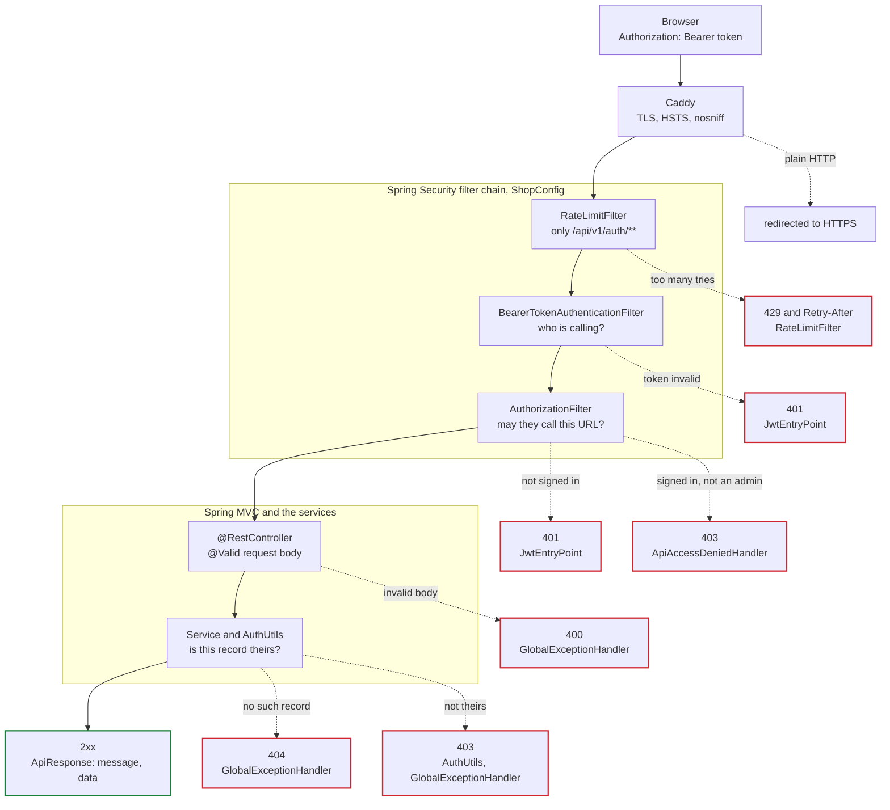
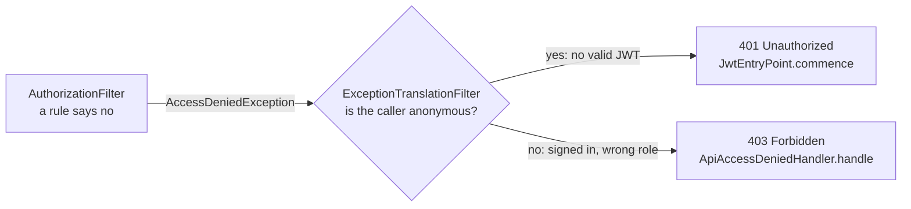
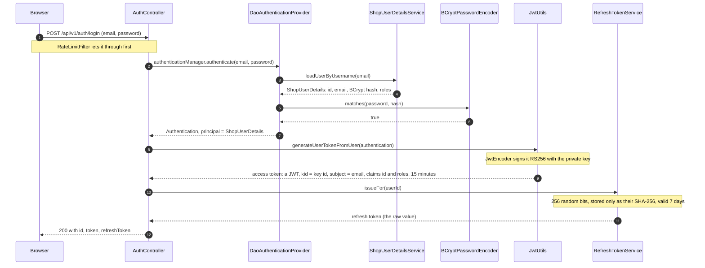
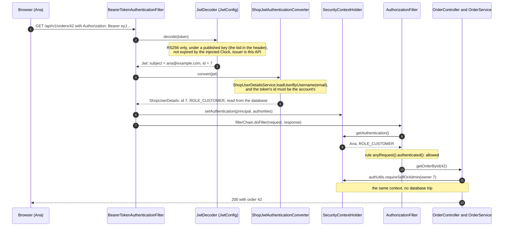
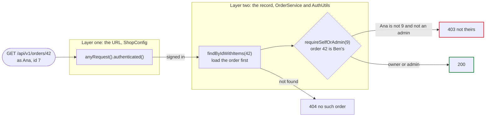
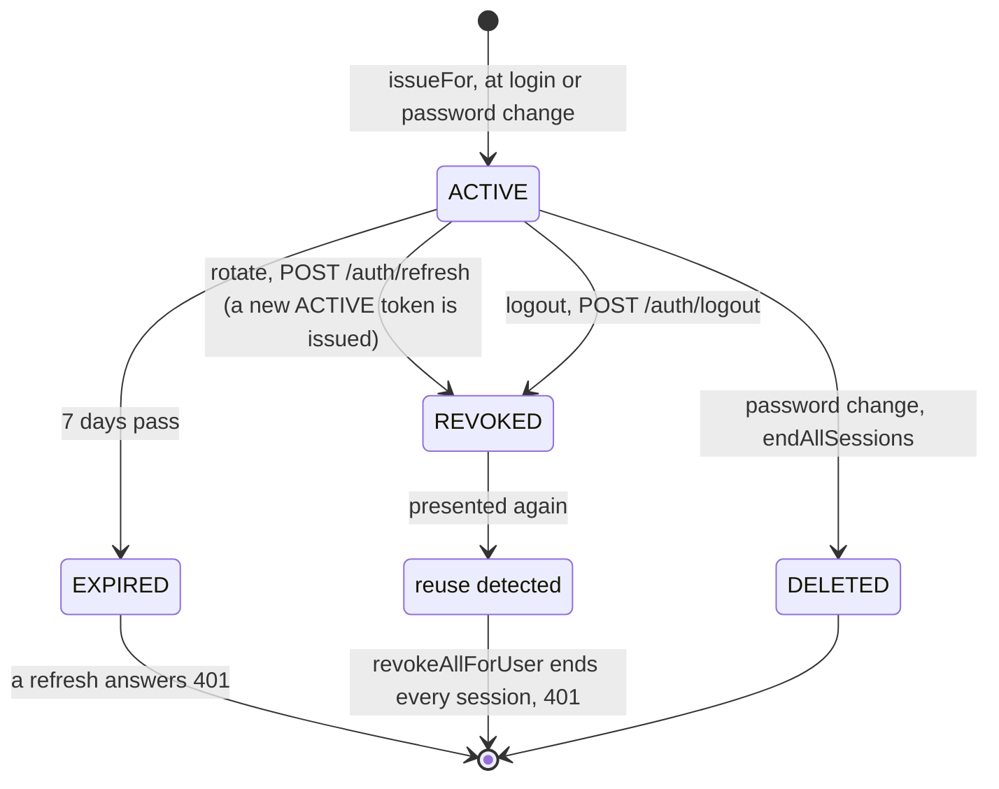
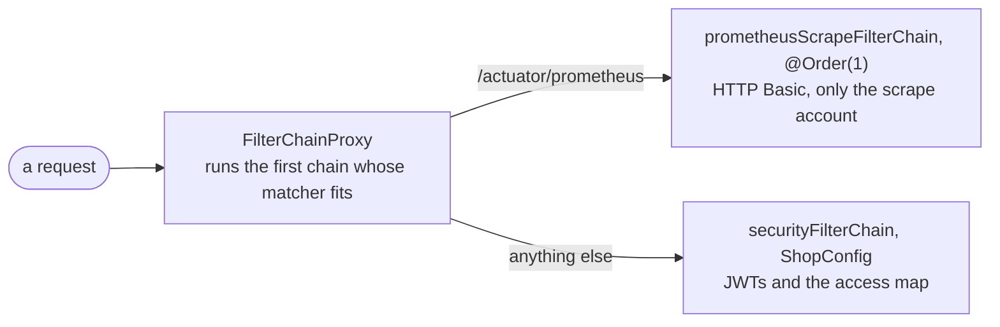
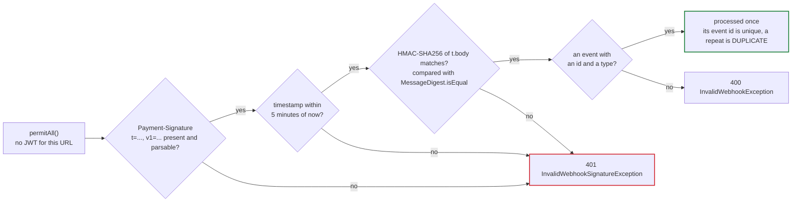
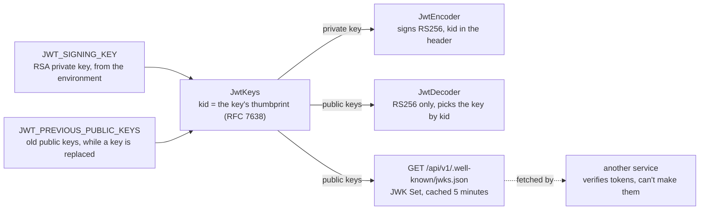

# Security design

> Condensed from **version 1.0** (October 2026); the full text is at the tag
> [`security-design-v1.0`](https://github.com/Aryankanani1/shopping-cart-spring-security/blob/security-design-v1.0/docs/security-design.md).
> A learning resource, not a security audit. To report a security problem, see
> [SECURITY.md](../SECURITY.md); please don't open a public issue for one.

How the API decides who is calling and what they may do, drawn from the classes
that do it. Access tokens are JWTs signed RS256 with a private key only the API
holds, checked with the published public key (section 14).

## 1. The road a request travels

Solid arrows: a request that gets through. Dotted: where it can stop, with the
status and the class that writes it.

| Spring Security piece | Here |
|---|---|
| `SecurityFilterChain` | `ShopConfig.securityFilterChain`, and a second chain for Prometheus (section 10) |
| `BearerTokenAuthenticationFilter` | Spring's own, from `oauth2ResourceServer()` |
| `JwtDecoder`, `JwtEncoder` | `NimbusJwtDecoder`, `NimbusJwtEncoder` in `JwtConfig`, keys from `JwtKeys` |
| `Converter<Jwt, AbstractAuthenticationToken>` | `ShopJwtAuthenticationConverter`, which loads the user |
| `OncePerRequestFilter` | `RateLimitFilter` |
| `UserDetailsService`, `UserDetails` | `ShopUserDetailsService`, `ShopUserDetails` (with the user's id) |
| `AuthenticationManager`, `DaoAuthenticationProvider` | beans in `ShopConfig`, called by `AuthController.login` |
| `PasswordEncoder` | `BCryptPasswordEncoder` |
| `SecurityContextHolder` | filled by the bearer filter, read by `AuthUtils` |
| `AuthenticationEntryPoint`, `AccessDeniedHandler` | `JwtEntryPoint` (401), `ApiAccessDeniedHandler` (403) |
| `CorsConfigurationSource` | `CorsConfig` |

Errors inside the filter chain never reach `GlobalExceptionHandler`, so the
filters write them themselves, as the same RFC 7807 JSON.

Code: [`ShopConfig`](../shop-identity/src/main/java/com/aryan/spring_security_demo/identity/security/config/ShopConfig.java),
[`GlobalExceptionHandler`](../shop-common/src/main/java/com/aryan/spring_security_demo/common/exception/GlobalExceptionHandler.java).

## 2. 401 or 403?

Code: [`JwtEntryPoint`](../shop-identity/src/main/java/com/aryan/spring_security_demo/identity/security/jwt/JwtEntryPoint.java),
[`ApiAccessDeniedHandler`](../shop-identity/src/main/java/com/aryan/spring_security_demo/identity/security/ApiAccessDeniedHandler.java).

## 3. Signing in

An unknown email and a wrong password get the same `401`, so the answer can't
reveal which emails have accounts.

Code: [`AuthController.login`](../shop-identity/src/main/java/com/aryan/spring_security_demo/identity/AuthController.java),
[`ShopUserDetailsService`](../shop-identity/src/main/java/com/aryan/spring_security_demo/identity/security/user/ShopUserDetailsService.java),
[`JwtUtils`](../shop-identity/src/main/java/com/aryan/spring_security_demo/identity/security/jwt/JwtUtils.java),
[`RefreshTokenService.issueFor`](../shop-identity/src/main/java/com/aryan/spring_security_demo/identity/RefreshTokenService.java).

## 4. Every request after that

No server-side session (`STATELESS`): the caller is rebuilt from the token on every
request.

- The user is reloaded from the database every time, so a deleted account or a
  removed role takes effect at once, and the token must name the account's id.
- An invalid token is a `401` on any URL, public ones too (RFC 6750).

Code: [`JwtConfig.jwtDecoder`](../shop-identity/src/main/java/com/aryan/spring_security_demo/identity/security/jwt/JwtConfig.java),
[`ShopJwtAuthenticationConverter`](../shop-identity/src/main/java/com/aryan/spring_security_demo/identity/security/jwt/ShopJwtAuthenticationConverter.java),
[`AuthUtils`](../shop-identity/src/main/java/com/aryan/spring_security_demo/identity/security/AuthUtils.java).

## 5. The access map

All URL rules are in `ShopConfig.securityFilterChain`, checked top to bottom.

| # | Method | Path | Rule | Why |
|---|---|---|---|---|
| 1 | `PUT` | `/api/v1/auth/password` | authenticated | Needs a signed-in caller; rate-limited like login |
| 2 | any | `/api/v1/auth/**` | permitAll | Login, refresh, logout |
| 3 | `POST` | `/api/v1/users` | permitAll | Signing up |
| 4 | `GET` | `/api/v1/.well-known/jwks.json` | permitAll | Public keys; nothing can be signed with them |
| 5 | `POST` | `/api/v1/payments/webhooks` | permitAll | Authenticated by its HMAC signature (section 10) |
| 6 | `GET` | `/products/**`, `/categories/**`, `/images/**` | permitAll | Browsing the catalogue |
| 7 | any | `/swagger-ui/**`, `/v3/api-docs/**` | permitAll | API docs; off in `prod` |
| 8 | any | actuator `health` | permitAll | Probes; details for admins only |
| 9 | any | every other actuator endpoint | `ROLE_ADMIN` | For operators |
| 10 | any | `/error` | permitAll | So an error can be shown |
| 11 | `POST`, `PUT`, `DELETE` | `/products/**`, `/categories/**`, `/images/**` | `ROLE_ADMIN` | Changing the catalogue |
| 12 | `PATCH` | `/api/v1/orders/*/status` | `ROLE_ADMIN` | Shipping and delivering |
| 13 | `GET` | `/api/v1/orders/admin` | `ROLE_ADMIN` | Every customer's orders |
| 14 | `POST` | `/api/v1/orders/*/refunds` | `ROLE_ADMIN` | Money goes back, so an admin decides |
| 15 | any | everything else | authenticated | Deny by default |

## 6. Is this record theirs?

A URL rule can't know who owns order 42; the service checks once the record is
loaded, through `AuthUtils` (no IDOR).

The other way: query only the caller's rows with `authUtils.currentUserId()`, as
the wishlist, notifications and cart do.

Code: [`OrderService`](../shop-order/src/main/java/com/aryan/spring_security_demo/order/OrderService.java),
[`CartService`](../shop-cart/src/main/java/com/aryan/spring_security_demo/cart/CartService.java),
[`WishlistService`](../shop-wishlist/src/main/java/com/aryan/spring_security_demo/wishlist/WishlistService.java).

## 7. Refresh tokens

The access token lasts 15 minutes; the refresh token 7 days, stored only as its
SHA-256, and spent on every refresh.

- A rotated token coming back means two parties hold it: every session of the user
  ends (`@Transactional(noRollbackFor = InvalidRefreshTokenException.class)`).
- In the browser, `client.ts` refreshes once on a `401`, shared between requests
  and tabs, then replays the request.

Code: [`RefreshTokenService.rotate`](../shop-identity/src/main/java/com/aryan/spring_security_demo/identity/RefreshTokenService.java),
[`client.ts`](../frontend/src/api/client.ts).

## 8. Rate limiting

`RateLimitFilter` runs before authentication, only for `/api/v1/auth/**`: a token
bucket per client address, 5 tokens, refilled at 5 a minute.

| Time | Tokens before | Result | Tokens after |
|---|---|---|---|
| 0 s | 5.00 | allowed | 4.00 |
| 1 s | 4.08 | allowed | 3.08 |
| 2 s | 3.17 | allowed | 2.17 |
| 3 s | 2.25 | allowed | 1.25 |
| 4 s | 1.33 | allowed | 0.33 |
| 5 s | 0.42 | `429`, `Retry-After: 7` | 0.42 |
| 12 s | 1.00 | allowed | 0.00 |

The address is `request.getRemoteAddr()`; in production
`SERVER_FORWARD_HEADERS_STRATEGY=native` takes it from Caddy (README, "Security
model").

Code: [`RateLimitFilter`](../shop-identity/src/main/java/com/aryan/spring_security_demo/identity/security/ratelimit/RateLimitFilter.java),
[`TokenBucket`](../shop-identity/src/main/java/com/aryan/spring_security_demo/identity/security/ratelimit/TokenBucket.java).

## 9. Passwords

- BCrypt, through the one `PasswordEncoder` bean; never logged or returned; hashed
  before any transaction opens; at most 72 bytes.
- Changing one (`PUT /api/v1/auth/password`) checks the current password, saves the
  new hash only if the stored one hasn't changed meanwhile, and ends every other
  session.

Code: [`UserService`](../shop-identity/src/main/java/com/aryan/spring_security_demo/identity/UserService.java),
[`UserAccountWriter`](../shop-identity/src/main/java/com/aryan/spring_security_demo/identity/UserAccountWriter.java).

## 10. Callers without a user

Prometheus and the payment provider can't sign in for a JWT; each is authenticated
another way.

Code: [`PrometheusScrapeSecurityConfig`](../shop-identity/src/main/java/com/aryan/spring_security_demo/identity/security/config/PrometheusScrapeSecurityConfig.java),
[`WebhookSignature.verify`](../shop-payment/src/main/java/com/aryan/spring_security_demo/payment/WebhookSignature.java),
[`PaymentWebhookService.receive`](../shop-payment/src/main/java/com/aryan/spring_security_demo/payment/PaymentWebhookService.java).

## 11. Sessions, CSRF, CORS and headers

| | |
|---|---|
| Sessions | `STATELESS`: no `HttpSession` |
| CSRF | Off: the credential is the `Authorization` header, which a browser never adds by itself |
| Tokens in the browser | `localStorage` (`tokenStore.ts`); React escapes everything it renders, no raw HTML |
| CORS | Only origins in `app.cors.allowed-origins`, never with credentials (`CorsConfig`) |
| Caddy | TLS, HTTP redirect, no `TRACE`, HSTS, `nosniff`, `Referrer-Policy`, no `Server` header ([`deploy/Caddyfile`](../deploy/Caddyfile)) |

## 12. Status codes and who sends them

| Code | Means here | Written by |
|---|---|---|
| `400` | Invalid body, a firewall-rejected request, or a webhook body that isn't an event | `GlobalExceptionHandler` |
| `401` | No valid JWT on a secured URL | `JwtEntryPoint` |
| `401` | Wrong email or password; a bad refresh token or webhook signature | `GlobalExceptionHandler` |
| `403` | Signed in, but the URL needs `ROLE_ADMIN` | `ApiAccessDeniedHandler` |
| `403` | The record belongs to someone else | `AuthUtils`, then `GlobalExceptionHandler` |
| `404` | No such record (looked up before ownership) | `GlobalExceptionHandler` |
| `429` | Too many `/auth` requests, with `Retry-After` | `RateLimitFilter` |

## 13. Key decisions

| Decision | Why | Rejected alternative |
|---|---|---|
| Every URL rule in one `SecurityFilterChain`, admin rules as `hasAuthority("ROLE_ADMIN")` | The access map reads in one place | `@PreAuthorize` on each controller |
| Deny by default | A new endpoint is never public by accident | Listing the protected paths |
| Ownership checked in the service, or queries scoped to `currentUserId()` | A URL rule can't know who owns a record | Trusting a client-sent id |
| The user reloaded on every request, the token bound to the account's id | Removals take effect at once | Trusting the token's roles until expiry |
| 15-minute access token, 7-day rotating refresh token stored as SHA-256 | Short-lived leaks, revocable sessions, reuse noticed | Long-lived tokens; raw refresh tokens |
| `Authorization` header, `STATELESS`, CSRF off | No cookie, no CSRF, no session store | Cookie sessions with CSRF tokens |
| `/auth/**` rate-limited per address, before authentication | Guessing is slowed before any password work | No limit |
| Filter-chain errors written as RFC 7807 by the filters | Every error looks the same | Spring's default error pages |
| RS256 with a published public key | Services can check tokens without being able to make them | HMAC with a shared secret |
| Spring's resource-server support | Parsing and validation are Spring's, not hand-written | A custom token filter |

## 14. Signing keys and the published public keys

- `JWT_SIGNING_KEY`: an RSA private key (2048 bits or more, PKCS#8 DER, Base64);
  the app won't start without a usable one. Dev and test may generate a throwaway
  key at startup, so no private key is ever committed.
- Replacing it: set the new key, keep the old public key in
  `JWT_PREVIOUS_PUBLIC_KEYS` for one access-token lifetime (15 minutes), then empty it.

Code: [`JwtKeys`](../shop-identity/src/main/java/com/aryan/spring_security_demo/identity/security/jwt/JwtKeys.java),
[`JwtConfig`](../shop-identity/src/main/java/com/aryan/spring_security_demo/identity/security/jwt/JwtConfig.java),
[`JwksController`](../shop-identity/src/main/java/com/aryan/spring_security_demo/identity/JwksController.java).

## 15. Reading the code in order

1. [`ShopConfig`](../shop-identity/src/main/java/com/aryan/spring_security_demo/identity/security/config/ShopConfig.java): the filter chain, the access map, the beans.
2. [`JwtConfig`](../shop-identity/src/main/java/com/aryan/spring_security_demo/identity/security/jwt/JwtConfig.java), [`JwtKeys`](../shop-identity/src/main/java/com/aryan/spring_security_demo/identity/security/jwt/JwtKeys.java), [`JwtUtils`](../shop-identity/src/main/java/com/aryan/spring_security_demo/identity/security/jwt/JwtUtils.java), [`ShopJwtAuthenticationConverter`](../shop-identity/src/main/java/com/aryan/spring_security_demo/identity/security/jwt/ShopJwtAuthenticationConverter.java): tokens.
3. [`ShopUserDetailsService`](../shop-identity/src/main/java/com/aryan/spring_security_demo/identity/security/user/ShopUserDetailsService.java), [`ShopUserDetails`](../shop-identity/src/main/java/com/aryan/spring_security_demo/identity/security/user/ShopUserDetails.java): the user as Spring sees it.
4. [`AuthController`](../shop-identity/src/main/java/com/aryan/spring_security_demo/identity/AuthController.java), [`RefreshTokenService`](../shop-identity/src/main/java/com/aryan/spring_security_demo/identity/RefreshTokenService.java): login, refresh, logout, password change.
5. [`AuthUtils`](../shop-identity/src/main/java/com/aryan/spring_security_demo/identity/security/AuthUtils.java), then `OrderService.getOrder`: ownership.
6. [`JwtEntryPoint`](../shop-identity/src/main/java/com/aryan/spring_security_demo/identity/security/jwt/JwtEntryPoint.java), [`ApiAccessDeniedHandler`](../shop-identity/src/main/java/com/aryan/spring_security_demo/identity/security/ApiAccessDeniedHandler.java), [`GlobalExceptionHandler`](../shop-common/src/main/java/com/aryan/spring_security_demo/common/exception/GlobalExceptionHandler.java): how each no is written.
7. [`RateLimitFilter`](../shop-identity/src/main/java/com/aryan/spring_security_demo/identity/security/ratelimit/RateLimitFilter.java), [`TokenBucket`](../shop-identity/src/main/java/com/aryan/spring_security_demo/identity/security/ratelimit/TokenBucket.java): a filter of your own.
8. [`CorsConfig`](../shop-identity/src/main/java/com/aryan/spring_security_demo/identity/security/config/CorsConfig.java), [`PrometheusScrapeSecurityConfig`](../shop-identity/src/main/java/com/aryan/spring_security_demo/identity/security/config/PrometheusScrapeSecurityConfig.java), [`WebhookSignature`](../shop-payment/src/main/java/com/aryan/spring_security_demo/payment/WebhookSignature.java): the special cases.

The integration tests show each rule from the other side:
`./mvnw test -pl shop-app -am -Dgroups=integration` (Docker needed).
